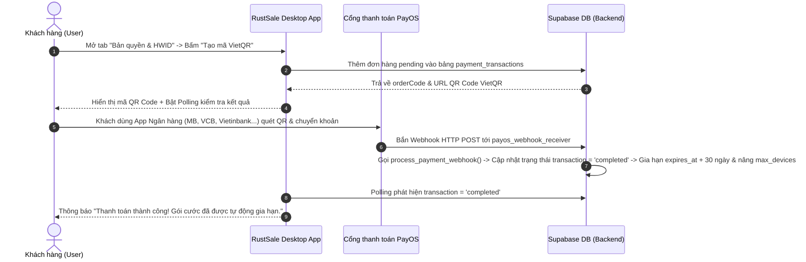

# Hướng dẫn chi tiết: Tích hợp Webhook Tự động Thanh toán PayOS với Supabase

Tài liệu này hướng dẫn bạn cách thiết lập **PayOS Webhook** để khi khách hàng quét mã VietQR và chuyển khoản thành công, hệ thống Supabase sẽ **tự động xác nhận giao dịch, gia hạn thời hạn sử dụng và nâng hạn mức số lượng máy (HWID)** cho khách hàng ngay lập tức.

---

## 🛠️ PHƯƠNG PHÁP 1: Dùng SQL Wrapper Endpoint trực tiếp trên Supabase (Nhanh nhất - Không cần Supabase CLI)

Phương pháp này sử dụng tính năng **PostgREST RPC API** có sẵn của Supabase. Bạn chỉ cần dán đoạn SQL bên dưới vào Supabase Dashboard là Webhook đã hoạt động!

### Bước 1: Thêm SQL Receiver Function trên Supabase
Vào **Supabase Dashboard** -> **SQL Editor** -> Dán đoạn mã SQL sau và nhấn **Run**:

```sql
-- Hàm tiếp nhận Webhook trực tiếp từ PayOS
CREATE OR REPLACE FUNCTION public.payos_webhook_receiver(
    code TEXT DEFAULT NULL,
    "desc" TEXT DEFAULT NULL,
    data JSON DEFAULT NULL,
    signature TEXT DEFAULT NULL
)
RETURNS JSON AS $$
DECLARE
    v_order_code BIGINT;
    v_amount NUMERIC(12,2);
    v_result JSON;
BEGIN
    -- Kiểm tra và giải mã thông tin từ JSON data của PayOS
    IF data IS NOT NULL THEN
        v_order_code := (data->>'orderCode')::BIGINT;
        v_amount := (data->>'amount')::NUMERIC(12,2);
    END IF;

    IF v_order_code IS NULL THEN
        RETURN json_build_object('success', false, 'reason', 'missing_order_code');
    END IF;

    -- Gọi hàm xử lý nâng gói / gia hạn hạn dùng
    v_result := public.process_payment_webhook(v_order_code, COALESCE(v_amount, 0), 'PAID');

    RETURN v_result;
END;
$$ LANGUAGE plpgsql SECURITY DEFINER;

-- Cấp quyền gọi API Webhook công khai cho PayOS (không cần đăng nhập)
GRANT EXECUTE ON FUNCTION public.payos_webhook_receiver TO anon, authenticated, service_role;
```

### Bước 2: Lấy Webhook URL của dự án Supabase
Webhook URL của bạn sẽ có cấu trúc:
`https://<YOUR_SUPABASE_PROJECT_REF>.supabase.co/rest/v1/rpc/payos_webhook_receiver`

*Ví dụ:* Nếu Project URL của bạn là `https://xyzcompany.supabase.co`, thì Webhook URL là:
`https://xyzcompany.supabase.co/rest/v1/rpc/payos_webhook_receiver`

### Bước 3: Điền Webhook URL vào PayOS Dashboard
1. Truy cập **[PayOS Dashboard](https://payos.vn)** -> Đăng nhập tài khoản.
2. Vào mục **Kênh thanh toán / Cấu hình Kênh** (hoặc **Tạo kênh thanh toán**).
3. Tại mục **Webhook URL**: Dán link Webhook URL ở Bước 2.
4. Bấm **Lưu thay đổi** hoặc **Kiểm tra kết nối (Test Webhook)**. PayOS sẽ gửi thử 1 request test và Supabase sẽ trả về HTTP status `200 OK`.

---

## 🛡️ PHƯƠNG PHÁP 2: Dùng Supabase Edge Function (Nâng cao - Xác thực chữ ký HMAC Checksum)

Nếu bạn muốn kiểm tra chữ ký an toàn (Checksum/Signature) từ PayOS để tránh việc kẻ xấu cố tình gửi request giả mạo, hãy dùng Supabase Edge Function.

### Bước 1: Mã nguồn Edge Function (`supabase/functions/payos-webhook/index.ts`)

```typescript
import { serve } from "https://deno.land/std@0.168.0/http/server.ts";
import { createClient } from "https://esm.sh/@supabase/supabase-js@2";

const SUPABASE_URL = Deno.env.get("SUPABASE_URL")!;
const SUPABASE_SERVICE_ROLE_KEY = Deno.env.get("SUPABASE_SERVICE_ROLE_KEY")!;

serve(async (req) => {
  // 1. Cho phép CORS Preflight / OPTIONS request
  if (req.method === "OPTIONS") {
    return new Response("ok", {
      headers: {
        "Access-Control-Allow-Origin": "*",
        "Access-Control-Allow-Methods": "POST, OPTIONS",
        "Access-Control-Allow-Headers": "authorization, x-client-info, apikey, content-type"
      }
    });
  }

  try {
    const payload = await req.json();
    console.log("PayOS Webhook Payload:", JSON.stringify(payload));

    const { code, data, success } = payload;

    // 2. Xử lý Ping test kết nối từ PayOS (khi bấm Test Webhook, data có thể null hoặc không chứa orderCode)
    if (!data || !data.orderCode) {
      console.log("PayOS Test Connection Ping OK");
      return new Response(JSON.stringify({ success: true, message: "Webhook URL test OK" }), {
        headers: { "Content-Type": "application/json" },
        status: 200
      });
    }

    const orderCode = Number(data.orderCode);
    const amount = Number(data.amount || 0);

    // 3. Khởi tạo Supabase client với Service Role Key
    const supabase = createClient(SUPABASE_URL, SUPABASE_SERVICE_ROLE_KEY);

    // 4. Gọi Stored Procedure process_payment_webhook trong Database
    const { data: resData, error } = await supabase.rpc("process_payment_webhook", {
      p_order_code: orderCode,
      p_amount: amount,
      p_status: (code === "00" || success) ? "PAID" : "FAILED"
    });

    if (error) {
      console.error("Supabase RPC Error:", error);
    }

    // 5. Luôn trả về 200 OK để PayOS không báo lỗi 400
    return new Response(JSON.stringify({ success: true, result: resData }), {
      headers: { "Content-Type": "application/json" },
      status: 200
    });
  } catch (err) {
    console.error("Webhook Exception:", err);
    return new Response(JSON.stringify({ success: true, warning: String(err) }), {
      headers: { "Content-Type": "application/json" },
      status: 200
    });
  }
});
```


### Bước 2: Deploy Edge Function
Dùng Supabase CLI để deploy:
```bash
npx supabase functions deploy payos-webhook --no-verify-jwt
```
Link Webhook sẽ là:
`https://<YOUR_SUPABASE_PROJECT_REF>.supabase.co/functions/v1/payos-webhook`

---

## 🔄 Quy trình hoạt động thực tế của khách hàng (End-to-End Flow)



---

## ❓ Câu hỏi thường gặp & Khắc phục sự cố

1. **Khách chuyển khoản rồi mà app chưa nhận?**
   * Trong Supabase SQL Editor, bạn có thể kiểm tra bảng giao dịch:
     `SELECT * FROM payment_transactions ORDER BY created_at DESC;`
   * Nếu cột `status` vẫn là `pending`, nghĩa là Webhook URL nhập trên PayOS chưa đúng hoặc bị sai mã `order_code`.
2. **Có thể test chuyển khoản mà không tốn tiền thật không?**
   * Trên PayOS Dashboard có chế độ **Sandbox (Test mode)**. Bạn có thể bật Sandbox để thử nghiệm gửi request giả lập thành công trước khi bật sang **Production**.
