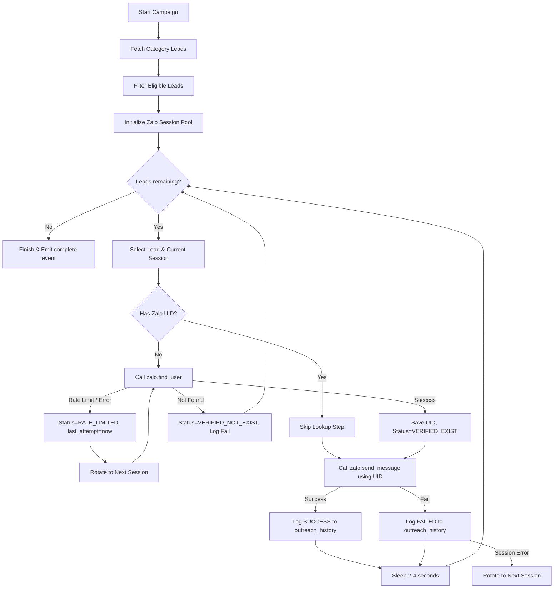

# Zalo Outreach Production-Grade Upgrade Design Specification

This document details the design and architecture for the production-grade upgrade of the Zalo Outreach Campaign system in the Tauri + SvelteKit + SQLite CRM. It addresses quota limits, lookup caching, session rotation, sending history tracking, and dynamic categorization.

---

## 1. Database Schema & Migration Specification

To support multi-account rotation, validation caching, and robust history filtering, the SQLite database at `src-tauri/src/db.rs` is upgraded.

### 1.1 New Tables

#### `categories`
Stores custom categories created by users.
```sql
CREATE TABLE IF NOT EXISTS categories (
    id INTEGER PRIMARY KEY AUTOINCREMENT,
    name TEXT NOT NULL UNIQUE
);
```

#### `lead_categories`
Junction table for many-to-many relationship between `leads` and `categories`.
```sql
CREATE TABLE IF NOT EXISTS lead_categories (
    lead_id INTEGER NOT NULL,
    category_id INTEGER NOT NULL,
    PRIMARY KEY (lead_id, category_id),
    FOREIGN KEY(lead_id) REFERENCES leads(id) ON DELETE CASCADE,
    FOREIGN KEY(category_id) REFERENCES categories(id) ON DELETE CASCADE
);
```

#### `outreach_history`
Detailed history of every single outreach attempt. Used for campaign analytics, error analysis, and campaign filters.
```sql
CREATE TABLE IF NOT EXISTS outreach_history (
    id INTEGER PRIMARY KEY AUTOINCREMENT,
    lead_id INTEGER NOT NULL,
    template_id INTEGER NOT NULL,
    status TEXT NOT NULL,          -- 'SUCCESS' or 'FAILED'
    error_message TEXT,             -- Detailed error string (e.g., 'Stranger block', 'Expired session')
    sent_at TEXT NOT NULL,          -- ISO8601 UTC timestamp
    session_imei TEXT NOT NULL,     -- Zalo account identifier used
    FOREIGN KEY(lead_id) REFERENCES leads(id) ON DELETE CASCADE,
    FOREIGN KEY(template_id) REFERENCES outreach_templates(id) ON DELETE CASCADE
);
```

### 1.2 Table Alterations (`leads`)
The `leads` table is altered to add the following columns:
*   `zalo_uid` TEXT: Cache for the unique Zalo user identifier.
*   `zalo_status` TEXT DEFAULT 'UNTESTED': Status constraints: `UNTESTED`, `VERIFIED_EXIST`, `VERIFIED_NOT_EXIST`, `RATE_LIMITED`.
*   `relationship_status` TEXT DEFAULT 'UNKNOWN': Relationship status constraints: `UNKNOWN`, `FRIEND`, `STRANGER_CAN_MESSAGE`, `STRANGER_BLOCKED`.
*   `last_lookup_attempt` TEXT: ISO8601 timestamp of the last lookup request (used for cooldown checks on `RATE_LIMITED`).

### 1.3 Concurrency Control (WAL Mode)
To ensure concurrent reads from SvelteKit don't clash with writes from the Tauri background outreach loop, SQLite is configured in **Write-Ahead Logging (WAL)** mode.
```rust
// In db.rs init_db:
conn.execute("PRAGMA journal_mode = WAL;", [])?;
conn.execute("PRAGMA synchronous = NORMAL;", [])?;
```

---

## 2. Backend Campaign Coordination & Rotation Flow

The outreach is handled in a Tauri command in `src-tauri/src/commands.rs` that manages the execution loop, caches Zalo UIDs to bypass lookup limits, and rotates active Zalo sessions.

### 2.1 Tauri Command Signature
```rust
#[tauri::command]
pub async fn send_zalo_campaign(
    app_handle: tauri::AppHandle,
    state: tauri::State<'_, DbState>,
    category_id: i32,
    template_id: i32,
    session_imeis: Vec<String>,
) -> Result<String, String>;
```

### 2.2 Execution Flow


### 2.3 Quota Optimization Rules
1.  **Direct Send via UID:** If `lead.zalo_uid` exists, skip the lookup `find_user` phase. This preserves the 30-lookup limit entirely for new number validations.
2.  **Permanent Exclusions:** If a number is marked `VERIFIED_NOT_EXIST`, it is skipped in all future campaigns.
3.  **Lookup Cooldown:** If `zalo_status = 'RATE_LIMITED'`, lookup is skipped unless at least 1 hour has elapsed since `last_lookup_attempt`.
4.  **Automatic Session Failover:** If `find_user` or message sending returns a rate limit or session expired error, the active connection switches to the next IMEI in `session_imeis`. If all sessions fail, the campaign pauses and alerts the user.

---

## 3. Frontend UI Specifications (SvelteKit)

### 3.1 Category Management Page
*   **Categories List:** CRUD operations for dynamic customer categories.
*   **Category Details:** View members, search leads to add in bulk, and remove leads from the category.
*   **Bulk Lead Action:** A context menu in the main Leads List allowing bulk assignment of selected leads to categories.

### 3.2 Zalo Outreach Filter Panel
Located in `src/lib/components/ZaloOutreach.svelte`, updated with the following:
*   **Account Pool:** Checkbox list of active Zalo sessions. Users select one or more accounts for automatic rotation.
*   **Outreach Target Selection:**
    *   Dropdown to select target Category.
    *   Outreach condition filter:
        *   `Never Sent`: Leads in category with no record in `outreach_history` for any template.
        *   `Template Success`: Leads who received a specific template successfully.
        *   `Last Attempt Failed`: Leads whose most recent outreach attempt failed (allows retry on different accounts).
*   **Real-time Campaign Console:**
    *   Visual progress bar.
    *   Console output showing session rotation warnings, lookup successes/failures, and message delivery statuses in real-time.
