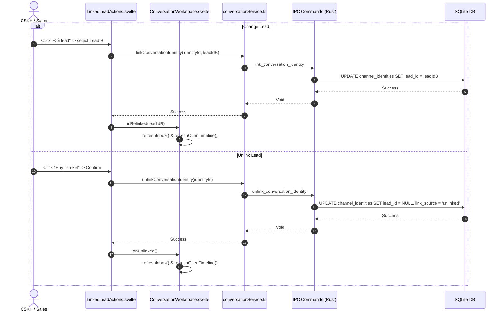

# Design Specification: Conversation Lead Linking Management (Change & Unlink Lead)

**Date:** 2026-08-01
**Status:** Proposed
**Author:** Antigravity AI

---

## 1. Overview & Objectives

Currently in RustSale v2 Unified Conversations:
- Conversations associated with unknown contacts (`kind === 'unknown'`) feature actions to **Link to Lead** or **Create Lead**.
- Once a conversation is linked to a lead (`kind === 'lead'`), there is no UI control in the conversation header to change the linked lead or remove (unlink) the lead association.

This design specification introduces full lead association management for linked conversations:
1. **Change Lead (Đổi lead)**: Re-associate an existing identity with a different CRM Lead.
2. **Unlink Lead (Hủy liên kết lead)**: Disassociate an identity from its current CRM Lead, resetting `lead_id = NULL` and returning the conversation to `unknown` state.

---

## 2. Architecture & Data Flow



---

## 3. Backend Changes (Rust `src-tauri`)

### 3.1 Repository (`src-tauri/src/conversation/repository.rs`)
Add `unlink_identity(identity_id: i64) -> Result<i64>`:
```rust
pub fn unlink_identity(&self, identity_id: i64) -> Result<i64> {
    let mut conn = open_db_connection(&self.db_path)?;
    let tx = conn.transaction()?;
    tx.execute(
        "UPDATE channel_identities
         SET lead_id = NULL, link_source = 'unlinked', link_confidence = 0.0, verified_at = NULL, updated_at = ?1
         WHERE id = ?2",
        params![utc_now(), identity_id],
    )?;
    let conversation_id = tx
        .query_row(
            "SELECT cp.conversation_id
             FROM conversation_participants cp
             JOIN channel_conversations cc ON cc.id = cp.conversation_id
             WHERE cp.identity_id = ?1 AND cc.kind IN ('direct', 'email_thread')
             ORDER BY cc.last_message_at DESC, cc.id DESC
             LIMIT 1",
            [identity_id],
            |row| row.get::<_, i64>(0),
        )
        .optional()?
        .unwrap_or(0);
    tx.commit()?;
    Ok(conversation_id)
}
```

### 3.2 Service (`src-tauri/src/conversation/service.rs`)
Add `unlink_identity(&self, identity_id: i64) -> Result<()>`:
- Calls `repository.unlink_identity(identity_id)`.
- Emits invalidation event via `self.events.publish(ConversationInvalidatedEvent { conversation_id, lead_id: None })`.

### 3.3 Commands (`src-tauri/src/conversation/commands.rs`)
Expose Tauri command `unlink_conversation_identity`:
```rust
#[derive(Debug, Deserialize)]
#[serde(rename_all = "camelCase")]
pub struct UnlinkIdentityRequest {
    pub identity_id: i64,
}

#[tauri::command]
pub fn unlink_conversation_identity(
    state: tauri::State<'_, ConversationState>,
    request: UnlinkIdentityRequest,
) -> Result<(), String> {
    state
        .service
        .unlink_identity(request.identity_id)
        .map_err(|error| error.to_string())
}
```
Register `unlink_conversation_identity` in `src-tauri/src/lib.rs` invoke_handler.

---

## 4. Frontend Service & Types (`src/lib/services/conversationService.ts`)

Export new IPC wrapper:
```typescript
export const unlinkConversationIdentity = (identityId: number) =>
  invoke<void>('unlink_conversation_identity', { request: { identityId } });
```

---

## 5. UI Components

### 5.1 New Component: `LinkedLeadActions.svelte` (`src/lib/components/conversation/LinkedLeadActions.svelte`)
Props:
- `item: InboxItem`
- `onRelinked?: (leadId: number) => void`
- `onUnlinked?: () => void`

Features:
- **Button "Đổi lead"**: Opens dialog (reusing CRM lead list search modal from `UnknownContactActions.svelte` pattern) allowing user to choose another lead, calling `linkConversationIdentity(item.identityId, newLeadId)`.
- **Button "Hủy liên kết"**: Opens confirm dialog with warning (*"Bạn có chắc chắn muốn gỡ liên kết giữa cuộc trò chuyện này và lead [Tên Lead]?"*), calling `unlinkConversationIdentity(item.identityId)`.

### 5.2 Header Integration: `ConversationWorkspace.svelte`
In header section:
```svelte
{#if selectedItem.kind === 'unknown'}
  <UnknownContactActions item={selectedItem} onLinked={handleLinked} />
{:else if selectedItem.kind === 'lead'}
  <LinkedLeadActions item={selectedItem} onRelinked={handleLinked} onUnlinked={handleUnlinked} />
{/if}
```
`handleUnlinked()` re-fetches inbox and timeline, updating selection seamlessly.

---

## 6. Testing & Quality Assurance

1. **Rust Integration Tests (`src-tauri/src/conversation/repository_test.rs` & `commands_test.rs`)**:
   - Test `unlink_identity` resets `lead_id` to NULL and publishes invalidation event.
   - Test `unlink_conversation_identity` IPC command returns Ok(()).
2. **Frontend Component Unit Tests (`src/lib/components/conversation/__tests__/LinkedLeadActions.spec.ts`)**:
   - Test rendering "Đổi lead" & "Hủy liên kết" buttons when `item.kind === 'lead'`.
   - Test modal opening, search filtering, relinking, and confirm unlinking triggers proper callbacks.
3. **End-to-End Workflow Verification**:
   - Run `bun test` across the project suite.
   - Run `bun run build` to verify TypeScript compile check.
