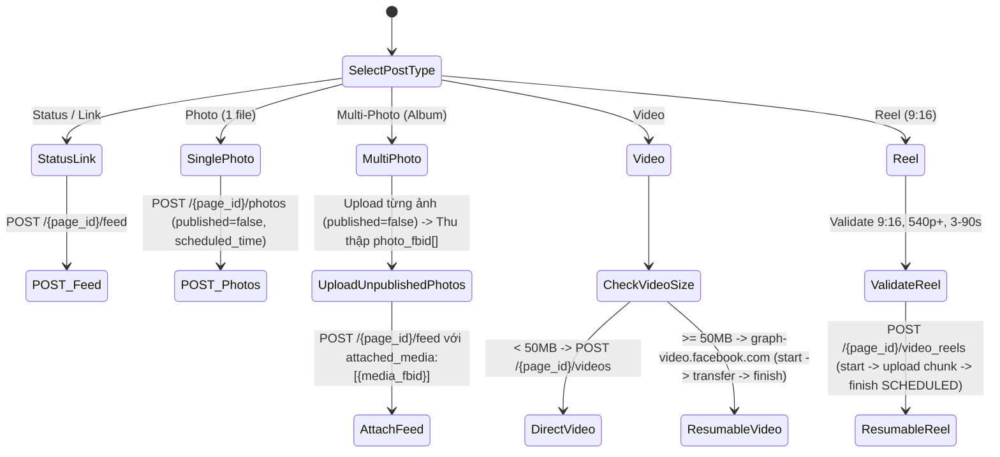

# Facebook Integration Design Specification — RustSale v2

**Date:** 2026-08-21  
**Status:** Approved for Implementation Planning  
**Author / Reviewer:** Antigravity Team & Lead Architect  
**Target Platform:** Tauri 2.0 (Rust) + Svelte 5 (Runes) + SQLite Local + Supabase (Auth, RLS, Edge Functions)

---

## 1. Executive Summary & Architecture Overview

The Facebook Integration module empowers RustSale v2 with enterprise-grade Meta capabilities across three pillars:
1. **Unified Omnichannel Messenger Inbox (`/conversation`)**: Seamless 2-way real-time messaging with Facebook Pages, integrating directly into the existing RustSale unified inbox alongside Zalo and Email.
2. **Facebook Post Scheduler & Planner (`/facebook`)**: Dual-mode scheduling (Meta-side 10m–30d & Local-queued >30d) supporting Status, Link, Single Photo, Multi-photo Albums, Videos, and Reels with live Desktop/Mobile feed previews.
3. **Automations & Growth Engine**: Compliant Private Reply for comments, 24-hour window countdown with Message Tag gating, Lead Ads instant CRM ingestion, and proactive Page Health monitoring.

### High-Level Architecture

```mermaid
flowchart TD
    subgraph Meta_Cloud ["Meta Cloud Platform (Graph API v26.0+)"]
        FB_User["Khách hàng Facebook"]
        FB_Send["Send API / Feed API"]
        FB_Hook["Meta Webhooks (messages, feed, leadgen)"]
    end

    subgraph Supabase_Cloud ["Supabase Cloud Relay & Auth Bridge"]
        EdgeOAuth["Edge Function: /meta-oauth (Exchange Tokens)"]
        EdgeDebug["Edge Function: /meta-debug-token (Inspect Scopes)"]
        EdgeHook["Edge Function: /meta-webhook (HMAC Raw Body Verify)"]
        TenantMap[("meta_tenant_pages (Tenant <-> Page Mapping)")]
        BufferDB[("meta_webhook_buffer (Durable RLS Queue)")]
        Realtime["Supabase Realtime (Tenant Scoped Private Channel)"]
    end

    subgraph Desktop_App ["RustSale Desktop App (Local-First Native)"]
        DeepLink["tauri-plugin-deep-link (rustsale://auth/facebook)"]
        Stronghold["Tauri Stronghold / OS Keyring (Encrypted Local Storage)"]
        RustSyncWorker["Rust Inbound Sync Worker (Catch-up + Realtime)"]
        RustOutbox["Rust Outbox Sender (Exponential Backoff + Error Classifier)"]
        SQLite[("Local SQLite DB (channel_accounts, messages, posts)")]
        MediaCache["Local Media Cache (Sanitized / Attachments)"]
        SvelteUI["Svelte 5 Runes UI (/conversation, /facebook)"]
    end

    %% Auth Flow
    SvelteUI -->|Bấm Kết nối Page| DeepLink
    EdgeOAuth -->|App Secret Exchange| DeepLink
    DeepLink -->|Lưu Encrypted Token| Stronghold

    %% Webhook Flow
    FB_User -->|Nhắn tin / Comment| FB_Hook
    FB_Hook -->|POST with X-Hub-Signature-256| EdgeHook
    EdgeHook -->|Unpack entry[] & INSERT| BufferDB
    BufferDB -->|Broadcast Event| Realtime
    Realtime -.->|Live Event| RustSyncWorker
    RustSyncWorker -->|Dedup & Catch-up Sync| SQLite
    RustSyncWorker -->|Tải Media Cục bộ| MediaCache
    SQLite -->|Reactive Timeline| SvelteUI

    %% Outbound Flow
    SvelteUI -->|Gửi tin / Đăng bài| RustOutbox
    RustOutbox -->|POST /<page_id>/messages /feed| FB_Send
```

---

## 2. Security, Authentication & Token Lifecycle

### 2.1 Zero-Secret Desktop Architecture
- **Strict Rule:** Meta `client_secret` and App Access Tokens (`app_id|app_secret`) MUST NEVER reside within the desktop binary.
- **Authorization Code Flow:**
  1. Desktop app triggers system browser to open Meta OAuth:
     `https://www.facebook.com/v26.0/dialog/oauth?client_id={APP_ID}&redirect_uri={EDGE_FN_CALLBACK}&state={CSRF_STATE}&scope=pages_messaging,pages_manage_posts,pages_read_engagement,pages_show_list,leads_retrieval`
  2. Meta redirects to Supabase Edge Function (`/meta-oauth-callback`).
  3. Edge Function verifies `state`, exchanges `code` for short-lived user token, and exchanges again for **Long-lived User Token** (60-day validity) using `client_secret`.
  4. Edge Function queries `GET /me/accounts` to retrieve all Page Access Tokens (never-expiring unless revoked).
  5. Edge Function stores tenant-to-page ownership mapping into `meta_tenant_pages (tenant_id UUID, page_id TEXT)`.
  6. Edge Function redirects to Desktop App via deep-link: `rustsale://auth/facebook?session_id={SESSION_UUID}`.
  7. Desktop App downloads encrypted page tokens and stores master key in **Tauri Stronghold / OS Keyring**.

### 2.2 Token Inspection & Status Machine
- Scheduled background task calls Edge Function `/meta-debug-token` to inspect `debug_token`.
- Token States:
  - `valid`: Token active and operational.
  - `revoked`: User changed password, revoked permissions, or lost admin role on Page.
  - `user_token_expired`: Long-lived User token (>60 days) expired. Page token still sends messages/posts, but user must re-authenticate to add/sync new Pages.

---

## 3. Database Schema & SQLite Data Architecture

All SQLite database migrations enforce `PRAGMA foreign_keys = ON;`.

### 3.1 SQLite Local Database (Desktop)

```sql
-- 1. Mở rộng channel_accounts (FK 1:1 cho Facebook Page)
-- Lưu ý: channel_accounts.provider_account_key lưu page_id
-- channel_accounts.capabilities_json lưu granted_scopes

-- 2. Token bảo mật cho từng Page
CREATE TABLE IF NOT EXISTS facebook_page_tokens (
    id INTEGER PRIMARY KEY AUTOINCREMENT,
    channel_account_id INTEGER NOT NULL UNIQUE,
    page_id TEXT NOT NULL UNIQUE,
    access_token_encrypted TEXT NOT NULL,
    token_status TEXT NOT NULL DEFAULT 'valid' CHECK (token_status IN ('valid', 'invalid', 'revoked')),
    granted_scopes_json TEXT NOT NULL DEFAULT '[]',
    last_validated_at TEXT,
    created_at TEXT NOT NULL,
    updated_at TEXT NOT NULL,
    FOREIGN KEY(channel_account_id) REFERENCES channel_accounts(id) ON DELETE CASCADE
);

-- 3. Scope PSID theo Page trong channel_identities
-- Cập nhật UNIQUE constraint cho channel_identities:
-- UNIQUE(channel, channel_account_id, external_id) với namespace='psid'

-- 4. Bảng quản lý Lên lịch đăng bài (Post Scheduler)
CREATE TABLE IF NOT EXISTS facebook_scheduled_posts (
    id INTEGER PRIMARY KEY AUTOINCREMENT,
    draft_group_id TEXT NOT NULL,                -- UUID gom nhóm khi đăng cùng lúc nhiều Page
    channel_account_id INTEGER NOT NULL,
    page_id TEXT NOT NULL,
    post_type TEXT NOT NULL CHECK (post_type IN ('status', 'link', 'photo', 'multi_photo', 'video', 'reel')),
    message TEXT NOT NULL,
    link_url TEXT,
    media_paths_json TEXT NOT NULL DEFAULT '[]', -- Đường dẫn file local
    scheduling_mode TEXT NOT NULL DEFAULT 'meta' CHECK (scheduling_mode IN ('meta', 'local_queued')),
    scheduled_publish_time TEXT,                 -- ISO-8601 UTC
    remote_post_id TEXT,                         -- ID bài viết trên Meta sau khi tạo
    upload_session_id TEXT,                      -- Session ID cho resumable video/reel
    idempotency_key TEXT NOT NULL UNIQUE,        -- UUIDv4 chống trùng
    status TEXT NOT NULL DEFAULT 'draft' CHECK (status IN ('draft', 'queued', 'publishing', 'scheduled_on_meta', 'published', 'failed')),
    error_code TEXT,
    error_message TEXT,
    created_at TEXT NOT NULL,
    updated_at TEXT NOT NULL,
    FOREIGN KEY(channel_account_id) REFERENCES channel_accounts(id) ON DELETE CASCADE
);
CREATE INDEX IF NOT EXISTS idx_fb_scheduled_posts_status ON facebook_scheduled_posts(status, scheduled_publish_time);
CREATE INDEX IF NOT EXISTS idx_fb_scheduled_posts_group ON facebook_scheduled_posts(draft_group_id);

-- 5. Bảng cấu hình Tự động phản hồi bình luận (Comment Automation)
CREATE TABLE IF NOT EXISTS facebook_comment_automations (
    id INTEGER PRIMARY KEY AUTOINCREMENT,
    channel_account_id INTEGER NOT NULL,
    page_id TEXT NOT NULL,
    rule_name TEXT NOT NULL,
    post_ids_json TEXT NOT NULL DEFAULT '[]',     -- Rỗng = tất cả bài viết
    keywords_json TEXT NOT NULL DEFAULT '[]',     -- Rỗng = bắt tất cả comment
    match_mode TEXT NOT NULL DEFAULT 'contains' CHECK (match_mode IN ('contains', 'exact', 'regex', 'all')),
    auto_like INTEGER NOT NULL DEFAULT 1 CHECK (auto_like IN (0, 1)),
    public_reply_template TEXT,
    private_reply_template TEXT,                  -- Giới hạn 1 private reply / comment
    is_enabled INTEGER NOT NULL DEFAULT 1 CHECK (is_enabled IN (0, 1)),
    created_at TEXT NOT NULL,
    updated_at TEXT NOT NULL,
    FOREIGN KEY(channel_account_id) REFERENCES channel_accounts(id) ON DELETE CASCADE
);

-- 6. Bảng nhật ký phản hồi comment (Idempotency & Audit Log)
CREATE TABLE IF NOT EXISTS facebook_comment_logs (
    id INTEGER PRIMARY KEY AUTOINCREMENT,
    comment_id TEXT NOT NULL UNIQUE,
    page_id TEXT NOT NULL,
    post_id TEXT,
    sender_psid TEXT NOT NULL,
    sender_name TEXT,
    comment_text TEXT,
    automation_id INTEGER,
    like_status TEXT NOT NULL DEFAULT 'none' CHECK (like_status IN ('none', 'success', 'failed')),
    public_reply_status TEXT NOT NULL DEFAULT 'none' CHECK (public_reply_status IN ('none', 'success', 'failed')),
    private_reply_status TEXT NOT NULL DEFAULT 'none' CHECK (private_reply_status IN ('none', 'success', 'failed', 'skipped')),
    skip_reason TEXT,                            -- 'loop_guard', 'outside_7_days', 'already_replied'
    error_message TEXT,
    created_at TEXT NOT NULL,
    FOREIGN KEY(automation_id) REFERENCES facebook_comment_automations(id) ON DELETE SET NULL
);
CREATE INDEX IF NOT EXISTS idx_fb_comment_logs_page_date ON facebook_comment_logs(page_id, created_at);
```

### 3.2 Supabase Cloud Relay Schema & Multi-Tenant RLS

```sql
-- Mapping Tenant và Page sở hữu
CREATE TABLE IF NOT EXISTS meta_tenant_pages (
    id UUID PRIMARY KEY DEFAULT gen_random_uuid(),
    tenant_id UUID NOT NULL REFERENCES auth.users(id) ON DELETE CASCADE,
    page_id TEXT NOT NULL,
    page_name TEXT NOT NULL,
    created_at TIMESTAMPTZ NOT NULL DEFAULT now(),
    UNIQUE(tenant_id, page_id)
);
ALTER TABLE meta_tenant_pages ENABLE ROW LEVEL SECURITY;
CREATE POLICY "Tenants manage own pages" ON meta_tenant_pages
    FOR ALL USING (auth.uid() = tenant_id);

-- Durable Buffer nhận Webhook từ Meta
CREATE TABLE IF NOT EXISTS meta_webhook_buffer (
    id BIGINT GENERATED ALWAYS AS IDENTITY PRIMARY KEY,
    page_id TEXT NOT NULL,
    event_type TEXT NOT NULL,                    -- 'messages', 'message_echoes', 'message_deliveries', 'message_reads', 'message_reactions', 'feed', 'leadgen'
    event_key TEXT NOT NULL,                     -- mid, comment_id, leadgen_id, watermark, mid_sender
    payload JSONB NOT NULL,
    status TEXT NOT NULL DEFAULT 'pending' CHECK (status IN ('pending', 'synced', 'dead_letter')),
    created_at TIMESTAMPTZ NOT NULL DEFAULT now()
);
CREATE UNIQUE INDEX IF NOT EXISTS idx_meta_buffer_dedup ON meta_webhook_buffer(page_id, event_type, event_key);
CREATE INDEX IF NOT EXISTS idx_meta_buffer_sync ON meta_webhook_buffer(page_id, status, id);

ALTER TABLE meta_webhook_buffer ENABLE ROW LEVEL SECURITY;
CREATE POLICY "Tenants read own page buffer" ON meta_webhook_buffer
    FOR SELECT USING (
        page_id IN (SELECT page_id FROM meta_tenant_pages WHERE tenant_id = auth.uid())
    );
CREATE POLICY "Tenants update own page buffer" ON meta_webhook_buffer
    FOR UPDATE USING (
        page_id IN (SELECT page_id FROM meta_tenant_pages WHERE tenant_id = auth.uid())
    );
```

---

## 4. Webhook Relay & Inbound Synchronization Engine

### 4.1 Edge Function Webhook Handler (`/meta-webhook`)
1. **GET Verification Handshake:**
   - Evaluates `hub.mode == 'subscribe'` and `hub.verify_token == META_VERIFY_TOKEN`.
   - Returns raw `hub.challenge` string.
2. **POST Event Ingestion:**
   - Reads request **raw bytes** before any JSON parsing.
   - Calculates HMAC-SHA256 with `META_APP_SECRET` and compares with `X-Hub-Signature-256` in constant time.
   - Unpacks `entry[]` containing multiple `messaging[]` or `changes[]`.
   - Generates deterministic `event_key`:
     - `messages` / `message_echoes` → `entry.messaging.message.mid`
     - `feed` comments → `entry.changes.value.comment_id`
     - `leadgen` → `entry.changes.value.leadgen_id`
     - `deliveries` / `reads` → `{recipient_id}_{watermark}`
     - `reactions` → `{mid}_{sender_id}`
   - Batch inserts records into `meta_webhook_buffer` with `ON CONFLICT (page_id, event_type, event_key) DO NOTHING`.
   - Returns HTTP 200 OK immediately (< 1000ms).
   - Broadcasts real-time notification to tenant's private Supabase Realtime channel: `tenant:{tenant_id}`.

### 4.2 Desktop Catch-Up & Live Inbound Worker
- **Catch-up Sync Sequence:**
  1. On app startup or reconnect, desktop client queries `meta_webhook_buffer WHERE page_id IN (...) AND status = 'pending' ORDER BY id ASC`.
  2. Processes pending events sequentially into local SQLite database.
  3. Updates processed rows to `status = 'synced'`.
  4. Subscribes to live Realtime events. Live events undergo local `mid`/`comment_id` deduplication before rendering.
- **Echoes & Loop Protection:**
  - If `message_echoes` has `app_id == RUSTSALE_APP_ID`: Marks local outbox message as confirmed (`sent_at`), prevents creating duplicate message.
  - If `app_id != RUSTSALE_APP_ID`: Inserts as message sent by agent via Business Suite / Mobile app.
- **Media Cache Worker:**
  - Asynchronously downloads media from Meta CDN to `app_data/media/facebook/{mid}_{index}_{sanitized_filename}`.
  - Cleans up orphaned media upon conversation/lead deletion.

---

## 5. Outbound Messaging & 24-Hour Policy Compliance

### 5.1 Outbox Queue & Error Classification
Outbox sender classifies Meta API response errors into two categories:

| Error Category | Subcodes / Error Types | Action |
| :--- | :--- | :--- |
| **Transient Errors** | `613` (Rate limit), `32` (Page throttle), Network Timeout | Exponential Backoff Retry (1s, 2s, 4s, 8s... max 5 retries). |
| **Permanent Errors** | `2018278` (Outside 24h window without tag), `551` (User blocked Page), `190` (Token invalid/revoked) | Mark `status = 'dead_letter'`, halt retries, render actionable error prompt in UI. |

### 5.2 24-Hour Window & Message Tag Gate
- **Interactive Countdown**: UI displays dynamic countdown timer based on customer's last inbound message or reaction (e.g. *"Còn 08h 45m trong cửa sổ 24h"*).
- **Outside 24h Gate**:
  - When countdown expires, composer transitions to **Policy Mode**.
  - Dropdown mandates selecting a valid **Message Tag**:
    1. `CONFIRMED_EVENT_UPDATE` (Xác nhận sự kiện)
    2. `POST_PURCHASE_UPDATE` (Cập nhật đơn hàng / vận chuyển)
    3. `ACCOUNT_UPDATE` (Cập nhật tài khoản)
    4. `HUMAN_AGENT` (Nhân viên CSKH trả lời — **chỉ hiển thị khi Page đã được phê duyệt scope này**).
  - Client-side heuristic scanner flags promotional keywords (`sale`, `giảm giá`, `voucher`, `khuyến mãi`) to protect the Page from policy strikes.

### 5.3 Comment Automation & Private Reply
- **Send API Standard:** Uses `POST /{page_id}/messages` with `recipient: {"comment_id": "123_456"}` and `messaging_type: "RESPONSE"`.
- **7-Day Guard:** Strictly validates `comment_created_time >= now() - 7 days`.
- **Idempotency Guard:** Exactly 1 Private Reply per comment logged in `facebook_comment_logs`.

---

## 6. Post Scheduler & Multi-Type Media Engine

### 6.1 Dual-Mode Scheduling Specification
1. **Meta-side Scheduling (10 mins to 30 days):**
   - Uploads media and creates post on Meta with `published=false` and `scheduled_publish_time={UNIX_TIMESTAMP}`.
   - Status set to `scheduled_on_meta`.
   - Meta automatically publishes the post at the exact time, even when the user's PC is powered off.
   - Executes read-after-write verification: `GET /{remote_post_id}?fields=is_published,scheduled_publish_time`.
2. **Local-queued Scheduling (> 30 days):**
   - Keeps post locally with status `queued` and local media file paths. Media is NOT uploaded to Meta during draft/queue phase to prevent Meta CDN cleanup of unpublished assets.
   - Background worker monitors queue: When post time reaches `<= 29 days`, worker uploads media and transitions post to `scheduled_on_meta`.
   - **UX Safety Guard:** If the app is launched and a `queued` post's scheduled time has already passed, UI prompts: *"Đăng ngay / Dời lịch / Hủy bỏ"* instead of executing an unexpected late post.

### 6.2 Multi-Type Media Publishing Flow



### 6.3 Multi-Page Publishing Fan-Out
When user selects $N$ Pages, engine fans out into $N$ distinct `facebook_scheduled_posts` records sharing the same `draft_group_id`. Each record manages its own upload pipeline, media IDs, and status independently.

---

## 7. UI/UX Component Architecture (Svelte 5 Runes)

### 7.1 Unified Conversation Inbox (`src/lib/components/conversation/`)
- `ChannelBadges.svelte`: Messenger badge with characteristic blue-to-purple gradient.
- `ConversationItemRow.svelte`: Page avatar, Page Name badge, 24h status indicator.
- `ConversationWorkspace.svelte`:
  - 24-hour countdown badge in chat header.
  - Message Tag Selector modal/dropdown when outside 24h window.
  - Lead linking banner (`LinkedLeadActions.svelte`).
- `MessageComposer.svelte`: Character count (63,206 max limit), Quick Templates, Attachment Preview Queue.

### 7.2 Facebook Marketing Hub (`src/lib/components/facebook/`)
- `FacebookHub.svelte`: Main wrapper with 3 sub-tabs:
  1. `PageManager.svelte`: Fanpage list, token health check, 1-click re-auth, sync status.
  2. `PostPlanner.svelte`:
     - Left pane: Multi-page selector, Post type switcher, Rich text editor, Media drag-and-drop queue, Scheduling time picker.
     - Right pane: **Live Feed Preview** toggleable between **Facebook Desktop Feed** and **Facebook Mobile Feed** with authentic layout grids (1, 2, 3, 4+ photo layouts).
     - Bottom/Calendar view: Calendar & Kanban views for drafts, queued, scheduled, and published posts.
  3. `CommentAutomation.svelte`: Rule builder, keyword matcher, Auto-Like/Reply/Private-Reply toggles, and Real-time Audit Logs with `skipped` reasoning.

---

## 8. Meta App Review & Production Readiness Checklist

| Permission Scope | Purpose | Submission Asset Needed |
| :--- | :--- | :--- |
| `pages_messaging` | Inbound/Outbound chat in Unified Inbox | Screencast showing 2-way chat between customer & agent. |
| `pages_manage_posts` | Post Scheduler & Feed publishing | Screencast showing post creation, media upload, and scheduled publication on Page. |
| `pages_read_engagement` | Read posts & comments for Auto-Reply | Screencast showing comment triggering automated response. |
| `pages_show_list` | Fetch user's managed Pages during OAuth | Screencast of connection flow listing available Pages. |
| `leads_retrieval` | Sync Lead Ads forms directly to CRM | Screencast showing instant lead sync into RustSale CRM table. |
| `HUMAN_AGENT` *(Optional)* | 7-day extended CSKH response window | Justification and demo of live human agent support workflow. |

**Mandatory Legal Assets:**
- Public Privacy Policy URL & Terms of Service URL.
- User Data Deletion Callback endpoint hosted on Supabase Edge Function.
- Meta Business Verification with verified business documentation.

---

## 9. Phased Implementation Roadmap

- **Phase 1: Foundation & Messenger Inbox**
  - Supabase Edge Functions (`/meta-oauth`, `/meta-debug-token`, `/meta-webhook`).
  - Rust client (`v26.0`), Stronghold token storage, Channel adapter, Outbox queue.
  - Inbound catch-up sync & Svelte 5 Unified Inbox integration.
  - App Review & Business Verification preparation.
- **Phase 2: Post Scheduler & Live Preview**
  - Multi-type media pipeline (Photo, Album, Video resumable, Reel).
  - Dual-mode scheduler (Meta-side 10m-30d + Local queue >30d).
  - Svelte 5 Post Planner, Media Queue, and Live Desktop/Mobile Feed Preview.
- **Phase 3: Marketing Automations & Lead Ads**
  - Comment Automation Rule Builder & Send API Private Reply (1-reply guard).
  - Lead Ads webhook handler & automatic CRM lead creation.
  - Policy enforcement audit logs and Page health monitor.
