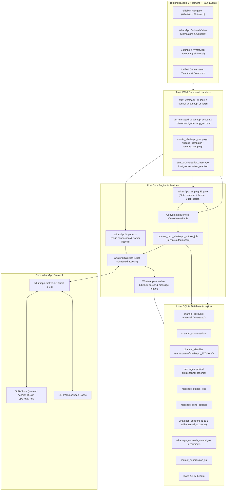
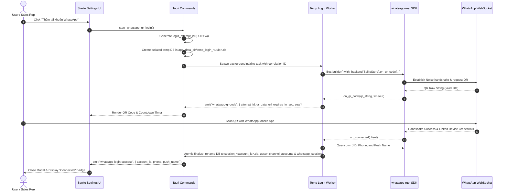

# Design Spec v1.1: WhatsApp Integration (Multi-Device Protocol & CRM Parity)

## 1. Context, Architecture Decision Record (ADR) & Risk Tier

### 1.1 Architecture Decision Record (ADR)
- **Selected Integration Mechanism**: Unofficial WhatsApp Multi-Device Protocol via [`whatsapp-rust`](https://docs.rs/whatsapp-rust/latest/whatsapp_rust/) (pinned at `=0.7.0` on crates.io).
- **Classification & Scope**:
  - This is a **Personal Multi-Device Connection (Community Protocol)**, not the official Meta WhatsApp Business Cloud API.
  - The feature is surfaced in the UI with clear operational indicators: *Personal WhatsApp Device Pairing*.
  - Rate limiting, randomized delays, and quiet hours are implemented as **Responsible Messaging & Rate Limiting Controls** (they do not guarantee immunity from Meta anti-spam / automated messaging heuristics).
  - Designed for 1-to-1 customer consultation, CRM timeline unification, and permission-based outreach with strict opt-out compliance.
- **Risk Classification**: **Tier 3 — Critical** according to [`docs/IMPLEMENTATION_COMPLETION_HARNESS.md`](file:///home/arch/Project/test/RustSale_v2/docs/IMPLEMENTATION_COMPLETION_HARNESS.md), touching Native IPC, Authentication & Cryptographic Keys, Local SQLite Migrations, File System Storage, and External WebSocket Networking.

---

## 2. System Architecture & Seam Boundaries



---

## 3. Database Model & Canonical Schema Reuse

### 3.1 Reuse of Canonical Tables
The system reuses the existing tables defined in [`src-tauri/src/conversation/schema.sql`](file:///home/arch/Project/test/RustSale_v2/src-tauri/src/conversation/schema.sql):
- `channel_accounts`: `channel = 'whatsapp'`, `provider_account_key` = E.164 phone string (e.g. `84901234567`).
- `channel_conversations`: `channel = 'whatsapp'`, `external_thread_id` = canonical JID (e.g. `84901234567@s.whatsapp.net` or `1234567890-987654321@g.us`).
- `channel_identities`: `channel = 'whatsapp'`, `identity_namespace = 'whatsapp_jid'`, `external_id` = full JID or LID.
- `messages`: unified schema with `channel = 'whatsapp'`.
- `message_outbox_jobs`: transactional message dispatch queue with retry & lease semantics.
- `message_send_batches`: transactional grouping for multi-part sends and forwards.

### 3.2 WhatsApp-Specific Tables

```sql
-- 1. WhatsApp Account Session Metadata (1-to-1 with channel_accounts)
CREATE TABLE IF NOT EXISTS whatsapp_sessions (
    channel_account_id INTEGER PRIMARY KEY REFERENCES channel_accounts(id) ON DELETE RESTRICT,
    account_key TEXT NOT NULL UNIQUE,
    phone_number TEXT NOT NULL,
    lid TEXT,
    push_name TEXT,
    avatar_url TEXT,
    session_db_filename TEXT NOT NULL,
    is_valid INTEGER NOT NULL DEFAULT 1 CHECK (is_valid IN (0, 1)),
    last_connected_at TEXT,
    last_error TEXT,
    created_at TEXT NOT NULL,
    updated_at TEXT NOT NULL
);

-- 2. Contact Suppression & Opt-Out List (Channel-aware)
CREATE TABLE IF NOT EXISTS contact_suppression_list (
    id INTEGER PRIMARY KEY AUTOINCREMENT,
    channel TEXT NOT NULL CHECK (channel IN ('whatsapp', 'zalo', 'email', 'messenger')),
    phone_or_email TEXT NOT NULL,
    reason TEXT NOT NULL,                         -- 'opt_out', 'manual_block', 'invalid_number', 'bounce'
    source TEXT NOT NULL,                         -- 'inbound_stop', 'manual', 'dispatch_error'
    created_at TEXT NOT NULL,
    UNIQUE(channel, phone_or_email)
);

CREATE INDEX IF NOT EXISTS idx_suppression_lookup 
ON contact_suppression_list(channel, phone_or_email);

-- 3. WhatsApp Outreach Campaigns
CREATE TABLE IF NOT EXISTS whatsapp_outreach_campaigns (
    id INTEGER PRIMARY KEY AUTOINCREMENT,
    name TEXT NOT NULL,
    template_id INTEGER REFERENCES whatsapp_outreach_templates(id) ON DELETE SET NULL,
    status TEXT NOT NULL CHECK (status IN ('draft', 'queued', 'running', 'pausing', 'paused', 'completed', 'partial', 'failed', 'cancelled')),
    total_recipients INTEGER NOT NULL DEFAULT 0,
    sent_count INTEGER NOT NULL DEFAULT 0,
    delivered_count INTEGER NOT NULL DEFAULT 0,
    read_count INTEGER NOT NULL DEFAULT 0,
    failed_count INTEGER NOT NULL DEFAULT 0,
    skipped_count INTEGER NOT NULL DEFAULT 0,
    assigned_account_ids_json TEXT NOT NULL DEFAULT '[]',
    rate_limit_min_delay_secs INTEGER NOT NULL DEFAULT 8,
    rate_limit_max_delay_secs INTEGER NOT NULL DEFAULT 20,
    burst_limit_per_batch INTEGER NOT NULL DEFAULT 25,
    burst_pause_secs INTEGER NOT NULL DEFAULT 60,
    quiet_hours_enabled INTEGER NOT NULL DEFAULT 1 CHECK (quiet_hours_enabled IN (0, 1)),
    quiet_hours_start TEXT NOT NULL DEFAULT '22:00',
    quiet_hours_end TEXT NOT NULL DEFAULT '07:30',
    timezone TEXT NOT NULL DEFAULT 'Asia/Ho_Chi_Minh',
    last_heartbeat_at TEXT,
    started_at TEXT,
    completed_at TEXT,
    created_at TEXT NOT NULL,
    updated_at TEXT NOT NULL
);

-- 4. WhatsApp Campaign Recipients (Idempotent Delivery Tracking)
CREATE TABLE IF NOT EXISTS whatsapp_campaign_recipients (
    id INTEGER PRIMARY KEY AUTOINCREMENT,
    campaign_id INTEGER NOT NULL REFERENCES whatsapp_outreach_campaigns(id) ON DELETE CASCADE,
    lead_id INTEGER REFERENCES leads(id) ON DELETE SET NULL,
    recipient_phone_raw TEXT NOT NULL,
    recipient_phone_e164 TEXT NOT NULL,
    recipient_jid TEXT NOT NULL,
    assigned_channel_account_id INTEGER REFERENCES channel_accounts(id) ON DELETE SET NULL,
    status TEXT NOT NULL CHECK (status IN ('pending', 'running', 'sent', 'delivered', 'read', 'failed', 'skipped', 'blocked', 'delivery_unknown')),
    skip_reason TEXT,
    rendered_text TEXT,
    rendered_image_url TEXT,
    message_id INTEGER REFERENCES messages(id) ON DELETE SET NULL,
    outbox_job_id TEXT REFERENCES message_outbox_jobs(id) ON DELETE SET NULL,
    attempt_count INTEGER NOT NULL DEFAULT 0,
    last_attempt_at TEXT,
    last_error TEXT,
    created_at TEXT NOT NULL,
    updated_at TEXT NOT NULL,
    UNIQUE(campaign_id, recipient_phone_e164)
);

CREATE INDEX IF NOT EXISTS idx_wa_campaign_recipients_claim
ON whatsapp_campaign_recipients(campaign_id, status, id);
```

### 3.3 Account Disconnect / Delete Semantics
- **Disconnect / Logout**: Calls `BotHandle::shutdown()`, revokes credentials if active, updates `channel_accounts.connection_status = 'disconnected'`, `whatsapp_sessions.is_valid = 0`. **Preserves all conversation history and CRM lead links**.
- **Permanent Purge**: A separate, explicit confirmation operation that archives or hard-purges historical data with safety prompts.

---

## 4. Authentication & QR Code Pairing Lifecycle



### 4.1 Login Correlation & Cancel Safety
- Every login request receives a unique `login_attempt_id`.
- If user closes the modal, UI calls `cancel_whatsapp_qr_login(login_attempt_id)`:
  - The worker's cancellation token is triggered immediately.
  - The temporary SQLite database is deleted from disk.
  - Any subsequent late/stale events from WhatsApp servers for that attempt are discarded.

---

## 5. JID Resolution, LID-PN Mapping & Lead Matching

### 5.1 Protocol JID Architecture
- Direct Chats: Standard user JID `<phone>@s.whatsapp.net` or LID `<lid>@lid`.
- Group Chats: Group JID `<group_id>@g.us`.
- Group Messages: Sender JID is extracted from the message metadata (`ctx.info.source.sender`), distinct from the chat JID (`ctx.info.source.chat`).
- The system utilizes `whatsapp_rust::types::Jid` parser rather than naive string manipulation.

### 5.2 Two-Way LID $\leftrightarrow$ Phone Resolution
- `whatsapp-rust` maintains an internal `lid_pn_cache`.
- On incoming messages with LID sender, the normalizer resolves the phone number via `lid_pn_cache` to ensure consistent lead matching.

### 5.3 E.164 Normalization & Multi-Lead Resolution
- **Module**: Dedicated `crate::conversation::whatsapp::phone` module.
- **Normalization Rule**:
  - Strips whitespace, dashes, parenthetical area codes.
  - Supports configurable default country code (default: `+84` for Vietnam).
  - Handles international numbers seamlessly (`+1`, `+65`, `+44`, `+81`, etc.).
  - Validates E.164 length (8 to 15 digits).
- **Lead Matching Invariant**:
  - When matching an incoming or outgoing WhatsApp phone number to `leads.phone`:
    - Exactly 1 matching Lead $\to$ Link `channel_identities.lead_id = lead.id`.
    - 0 matching Leads $\to$ `channel_identities.lead_id = NULL` (unlinked stranger).
    - $>1$ matching Leads (duplicate phone numbers in CRM) $\to$ `channel_identities.lead_id = NULL` with warning flag (never pick an arbitrary lead record).

---

## 6. Outbox Engine & Service Seam Integration

### 6.1 Concrete Outbox Worker
In `src-tauri/src/conversation/service.rs`, integrate `process_next_whatsapp_outbox_job`:

```rust
pub async fn process_next_whatsapp_outbox_job(
    &self,
    channel_account_id: i64,
    client: &dyn crate::conversation::whatsapp::client::WhatsAppClient,
) -> Result<bool> {
    let now = crate::conversation::types::utc_now();
    let job = match self.repository.claim_next_outbox_job(channel_account_id, &now)? {
        Some(job) => job,
        None => return Ok(false),
    };

    let result = match job.content_type.as_str() {
        "text" => {
            let text = job.text_content.as_deref().unwrap_or("");
            client.send_text(&job.external_thread_id, text, &job.id).await
        }
        "media" => {
            // handle attachment upload / CDN send
            client.send_media(&job.external_thread_id, &job.content_json, &job.id).await
        }
        "forward" => {
            client.forward_message(&job.external_thread_id, &job.content_json, &job.id).await
        }
        other => Err(anyhow!("Unsupported content type: {other}")),
    };

    match result {
        Ok(send_res) => {
            self.repository.mark_outbox_job_completed(&job.id, &send_res.provider_message_id, &now)?;
            Ok(true)
        }
        Err(err) => {
            let error_tax = categorize_whatsapp_error(&err);
            if error_tax.is_retryable && job.attempt_count < 3 {
                self.repository.schedule_outbox_retry(&job.id, &err.to_string(), error_tax.retry_delay(), &now)?;
            } else {
                self.repository.mark_outbox_job_failed(&job.id, &err.to_string(), &now)?;
            }
            Ok(false)
        }
    }
}
```

### 6.2 Error Taxonomy & Ambiguous Delivery
- **Auth Error** (`code 401`, session revoked) $\to$ Transition `channel_accounts.connection_status = 'invalid'`, pause queue.
- **Rate Limit / 429** $\to$ Exponential backoff cooldown.
- **Invalid JID / Number Not on WhatsApp** $\to$ Mark recipient failed, add to suppression list.
- **Network Timeout post-dispatch** $\to$ Mark status as `delivery_unknown`; **do not automatically re-dispatch** to avoid duplicate spamming.

---

## 7. Campaign Engine, Suppression List & Responsible Messaging

### 7.1 Pre-Dispatch Suppression Check
Prior to dispatching any message in a campaign:
1. Normalize recipient phone to E.164.
2. Check `contact_suppression_list` (`channel = 'whatsapp' AND phone_or_email = ?`). If present $\to$ immediately mark recipient as `skipped` with reason `opt_out_suppressed`.
3. Check quiet hours: If current time in campaign timezone falls within `quiet_hours_start` and `quiet_hours_end` $\to$ pause campaign execution until quiet hours elapse.
4. Spintax evaluation: Parse `{Hello|Hi|Greetings}` into distinct variations.
5. Dynamic tag replacement: Replace `[name]`, `[phone]`, `[company]`, `[category]`.

### 7.2 Multi-Account Round-Robin & Anti-Ban Controls
- Active WhatsApp accounts assigned to the campaign are rotated sequentially.
- Per-message delay: Random sleep between `rate_limit_min_delay_secs` (e.g. 10s) and `rate_limit_max_delay_secs` (e.g. 25s).
- Batch pause: After `burst_limit_per_batch` (e.g. 20 messages), pause execution for `burst_pause_secs` (e.g. 90s).

---

## 8. Frontend UI / UX Architecture

1. **Sidebar (`src/lib/components/Sidebar.svelte`)**:
   - Menu item: `WhatsApp Outreach` (`icon: MessageCircleMore`, color: Emerald).
2. **Outreach Page (`src/lib/components/WhatsAppOutreach.svelte`)**:
   - Lead audience selector with filters (Category, Unreached, Verified mobile).
   - Multi-account selector checkboxes for round-robin dispatch.
   - Template editor with Spintax helper and tag inserters (`[name]`, `[phone]`, etc.).
   - Campaign Console: Start, Pause, Resume, Stop buttons, live progress bar, statistics (Sent, Delivered, Failed, Skipped), and log viewer.
3. **Settings Page (`src/lib/components/settings/WhatsAppAccountsSettings.svelte`)**:
   - Replaces the disabled "Coming soon" state in `Settings.svelte`.
   - Card grid of connected WhatsApp accounts with phone number, push name, avatar, connection status, and last active timestamp.
   - "Thêm tài khoản" button opening the live QR Code Modal (with 20s auto-refresh countdown and scan instructions).
   - Reconnect, Verify, and Disconnect actions.
4. **Unified Conversation (`src/lib/components/conversation/`)**:
   - WhatsApp Channel Badge (Emerald) in conversation list and message bubbles.
   - WhatsApp reply target in composer.

---

## 9. Verification & Requirement Ledger (Harness Tier 3)

| ID | Requirement | Invariant | Positive Case | Failure / Adversarial Case | Evidence Level |
| :--- | :--- | :--- | :--- | :--- | :--- |
| **REQ-WA-01** | QR Pairing Lifecycle | Session DB stored in `app_data_dir`; authenticated account upserted atomically | User scans valid QR $\to$ account connects | QR expires / user cancels $\to$ temp DB purged, no orphan worker | E4 (Runtime test) |
| **REQ-WA-02** | Stale QR Rejection | Only events matching active `login_attempt_id` are processed | Valid sequence updates QR countdown | Out-of-order / cancelled attempt events ignored | E2 (Unit test) |
| **REQ-WA-03** | Inbound Sync | Inbound WhatsApp messages normalized to canonical `messages` table | Message delivered $\to$ visible in timeline | Duplicate stanza $\to$ idempotent UPSERT | E3 (Integration) |
| **REQ-WA-04** | LID-PN Resolution | Inbound LID sender maps to canonical E.164 phone | User message with LID sender linked to phone | LID miss $\to$ fallback to unlinked JID gracefully | E3 (Integration) |
| **REQ-WA-05** | Lead Phone Matching | Link CRM Lead if exactly 1 lead matches E.164 phone | 1 Lead matches $\to$ `channel_identities.lead_id` linked | 0 or $\ge 2$ Leads $\to$ remains unlinked | E2 (Unit test) |
| **REQ-WA-06** | Outbox Dispatch | Outbox worker sends via `WhatsAppClient` and commits provider message ID | Outbox job processed $\to$ marked completed | Network drop $\to$ scheduled retry with backoff | E3 (Integration) |
| **REQ-WA-07** | Ambiguous Timeout | Post-dispatch timeout must not cause duplicate re-sends | Timeout $\to$ status `delivery_unknown` | No immediate blind re-dispatch | E2 (Unit test) |
| **REQ-WA-08** | Suppression Check | Outreach skips any number in `contact_suppression_list` | Unsuppressed lead $\to$ dispatched | Suppressed number $\to$ marked skipped | E2 (Unit test) |
| **REQ-WA-09** | Spintax Engine | Text randomization produces valid permutations without malformed brackets | `{A\|B} text` $\to$ evaluates to `A text` or `B text` | Nested or empty brackets $\to$ safe fallback | E2 (Unit test) |
| **REQ-WA-10** | Campaign Lease & Crash Recovery | Interrupted campaigns resume from last pending recipient | App restarts mid-campaign $\to$ resumed cleanly | Double lease $\to$ rejected by DB lock | E3 (Integration) |
| **REQ-WA-11** | Disconnect vs Purge | Disconnecting account keeps customer CRM messages intact | Disconnect account $\to$ status `disconnected`, messages intact | Cascade delete blocked by FK constraint | E2 (Unit test) |
