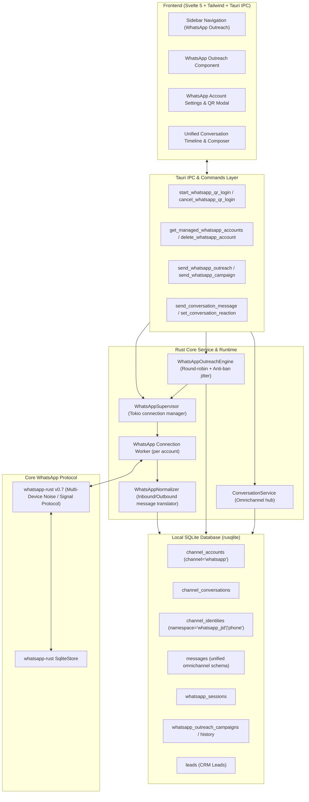

# Design Spec: WhatsApp Production Integration (Zalo Pattern Parity)

## 1. Overview & Objectives

This specification defines the production-grade integration of **WhatsApp** into **RustSale_v2**, achieving complete architectural and functional parity with the existing **Zalo** and **Email** channels.

### Key Capabilities
1. **QR Code & Pair-Code Authentication**: Native QR scan pairing and phone-based pair-code linking using `whatsapp-rust` (v0.7), persistent SQLite session state, and real-time QR streaming via Tauri IPC events.
2. **Multi-Account Management**: Run and supervise multiple WhatsApp personal / business numbers concurrently.
3. **Unified Conversation Inbox**: 2-way real-time messaging, typing indicators, read receipts, reactions, message quoting/replies, forwarding, voice/audio notes, and media attachments linked to CRM Leads via normalized E.164 phone numbers.
4. **WhatsApp Outreach Engine**: Mass messaging with customizable templates, variable tags (`[name]`, `[phone]`, `[company]`, `[category]`), Spintax randomization (`{Hello|Hi}`), image/media attachments, multi-account round-robin distribution, randomized anti-ban delays (jitter), burst limits, and live execution logging.
5. **Seamless UI/UX**: Dedicated `WhatsApp Outreach` sidebar menu, updated `Settings -> Channels -> WhatsApp` tab with QR code modal, and full representation in the `Conversation` workspace.

---

## 2. Architecture & System Decomposition



---

## 3. Data Model & Migrations

### 3.1 Database Schema Additions

#### 1. `whatsapp_sessions` Table
```sql
CREATE TABLE IF NOT EXISTS whatsapp_sessions (
    id INTEGER PRIMARY KEY AUTOINCREMENT,
    account_key TEXT NOT NULL UNIQUE,          -- JID or normalized phone e.g. "84901234567"
    phone_number TEXT,                          -- E.164 phone string e.g. "+84901234567"
    push_name TEXT,                             -- WhatsApp profile display name
    avatar_url TEXT,                            -- WhatsApp avatar CDN URL
    session_db_path TEXT NOT NULL,              -- Path to whatsapp-rust sqlite db store
    is_valid BOOLEAN NOT NULL DEFAULT 1,
    connection_status TEXT NOT NULL DEFAULT 'disconnected', -- 'connected', 'connecting', 'disconnected', 'invalid'
    last_connected_at TEXT,
    last_error TEXT,
    created_at TEXT NOT NULL DEFAULT (datetime('now')),
    updated_at TEXT NOT NULL DEFAULT (datetime('now'))
);
```

#### 2. `whatsapp_outreach_templates` Table
```sql
CREATE TABLE IF NOT EXISTS whatsapp_outreach_templates (
    id INTEGER PRIMARY KEY AUTOINCREMENT,
    name TEXT NOT NULL,
    content TEXT NOT NULL,
    image_url TEXT,
    created_at TEXT NOT NULL DEFAULT (datetime('now')),
    updated_at TEXT NOT NULL DEFAULT (datetime('now'))
);
```

#### 3. `whatsapp_outreach_history` Table
```sql
CREATE TABLE IF NOT EXISTS whatsapp_outreach_history (
    id INTEGER PRIMARY KEY AUTOINCREMENT,
    lead_id INTEGER REFERENCES leads(id) ON DELETE SET NULL,
    template_id INTEGER REFERENCES whatsapp_outreach_templates(id) ON DELETE SET NULL,
    channel_account_id INTEGER REFERENCES channel_accounts(id) ON DELETE SET NULL,
    provider_account_key TEXT NOT NULL,
    recipient_phone TEXT NOT NULL,
    recipient_jid TEXT NOT NULL,
    status TEXT NOT NULL,                      -- 'sent', 'failed', 'skipped'
    error_message TEXT,
    provider_message_id TEXT,
    sent_at TEXT NOT NULL DEFAULT (datetime('now'))
);
```

#### 4. Unified Omnichannel Foreign-Key Registration
In `channel_accounts`, `channel_conversations`, `channel_identities`, and `messages`:
- `channel` column values: `'whatsapp'` (already supported in `Channel` enum in `types.rs`).
- `identity_namespace`: `'whatsapp_jid'` or `'phone'`.
- `external_id`: `[E164_number]@s.whatsapp.net` for direct chats, `[group_id]@g.us` for groups.

---

## 4. WhatsApp Core Engine & Lifecycle

### 4.1 Login & QR Pairing Flow
1. User clicks **"Thêm tài khoản WhatsApp"** in UI.
2. Frontend invokes `start_whatsapp_qr_login()` -> Tauri creates an isolated session context in a designated data directory `~/.config/rustsale/whatsapp_sessions/<account_key>.db`.
3. Backend starts `Bot::builder().with_backend(SqliteStore::new(...)).on_qr_code(...)`.
4. The QR raw string is captured; backend emits Tauri event:
   ```json
   {
     "event": "whatsapp-qr-code",
     "payload": {
       "qr_raw": "2@...",
       "timeout_seconds": 20
     }
   }
   ```
5. Frontend renders the QR code with countdown timer.
6. When user scans QR in mobile WhatsApp:
   - `on_connected` fires with authenticated client.
   - Client fetches self JID and profile push name.
   - Account record upserted into `channel_accounts` and `whatsapp_sessions`.
   - Backend emits `whatsapp-login-success` with account metadata.
   - `WhatsAppSupervisor` registers the active client and starts background sync.

### 4.2 Reconnection & Multi-Account Supervision
- `WhatsAppSupervisor` runs background tasks for all enabled accounts.
- When app starts, `WhatsAppSupervisor::init_all_accounts()` connects each stored session.
- Automatic reconnect with exponential backoff (2s -> 5s -> 10s -> 30s) on network drop.
- Graceful shutdown on app exit using `BotHandle::shutdown()`.

---

## 5. Unified Conversation & Normalizer

### 5.1 Inbound Normalization
- `on_message` callback receives `MessageContext`:
  - Extract sender JID, conversation JID (`is_group = jid.ends_with("@g.us")`).
  - Extract text content via `ctx.message.text_content()`.
  - Extract attachments (Images, Videos, Audios, Documents, Voice Notes).
  - Extract quoted reply context (`ctx.message.get_base_message().extended_text_message.context_info`).
  - Upsert or find `channel_conversations` and `channel_identities`.
  - Auto-match `channel_identities.lead_id` if recipient phone matches existing CRM `leads.phone`.
  - Insert into `messages` table with status `received`.
  - Publish `ConversationInvalidatedEvent { channel: Channel::WhatsApp, conversation_id, ... }`.

### 5.2 Outbound Sending (`ChannelSender` Implementation)
- `WhatsAppSender` implements `ChannelSender`:
  - `send`: calls `client.send_text(target_jid, text)` or media send builder.
  - `set_reaction`: calls `client.react(target_msg_key, emoji)`.
  - `forward_message`: forwards message using CDN reuse or direct copy.

---

## 6. WhatsApp Outreach Engine & Anti-Ban Safety

### 6.1 E.164 Phone Normalization
- Cleans input numbers: strips non-digits, converts local Vietnamese prefixes (`09x`, `08x`, `03x`, `07x`, `05x`) to `+84` (`84901234567`).
- Formats target JID: `84901234567@s.whatsapp.net`.
- Verifies format validity before attempting dispatch.

### 6.2 Spintax & Personalization
- Variable tags: `[name]` -> Lead Name, `[phone]` -> Lead Phone, `[company]` -> Lead Company, `[category]` -> Category Name.
- Spintax syntax: `{Xin chào|Chào bạn|Kính chào}` randomly evaluates to one variation per lead.

### 6.3 Anti-Ban Protections
1. **Multi-Account Round-Robin**: Evenly splits lead batches across all selected WhatsApp accounts.
2. **Randomized Delay (Jitter)**: User-configurable safe interval (default: 8s - 20s between dispatches).
3. **Burst Limit & Batch Pauses**: Optional pause of 60s after every 25 messages.
4. **CRM Timeline Linking**: Sent outreach messages are saved directly into `messages` table so customer history is immediately unified.

---

## 7. Frontend UI / UX

### 7.1 Sidebar Navigation
- Add `WhatsApp Outreach` item in `src/lib/components/Sidebar.svelte` with `MessageCircleMore` icon (Emerald theme).

### 7.2 WhatsApp Outreach Page (`WhatsAppOutreach.svelte`)
- Lead filtering: Category filter, Keyword search, Unreached filter, Verified mobile filter.
- Account selector: Checkbox list of active WhatsApp accounts for round-robin.
- Template Manager: List, create, edit, delete templates with tag insertion buttons and image upload.
- Sending Console: Start, Pause, Resume, Stop controls, progress bar, real-time log box, and summary statistics.

### 7.3 Settings Page (`WhatsAppAccountsSettings.svelte`)
- Enables WhatsApp tab in `Settings.svelte`.
- Connected accounts list with status badges (`Connected`, `Connecting`, `Disconnected`, `Error`).
- "Thêm tài khoản" button opening QR Code Modal.
- Reconnect and Delete session actions.

### 7.4 Conversation Workspace Integration
- WhatsApp Channel Badges (Emerald color) in Conversation Sidebar.
- WhatsApp reply target support in composer.
- Full rendering of WhatsApp messages, media, reactions, and quotes.

---

## 8. Verification & Adversarial Quality Gates

1. **Unit & Contract Tests**:
   - `whatsapp::normalizer_test.rs`: Validate inbound/outbound text, media, reactions, and quotes.
   - `whatsapp::outreach_test.rs`: Validate phone normalization, spintax parsing, tag substitution, and round-robin distribution.
   - `whatsapp::supervisor_test.rs`: Validate account lifecycle, multi-account routing, and error recovery.
2. **Adversarial Scenarios**:
   - Invalid / malformed phone numbers -> gracefully skipped without crashing outreach.
   - Session disconnect during outreach batch -> marks current item failed, continues with remaining connected accounts or pauses.
   - Concurrent incoming messages during active mass outreach -> non-blocking, database transactions remain isolated.
   - QR code expiry -> auto-refresh event handled cleanly in UI.
