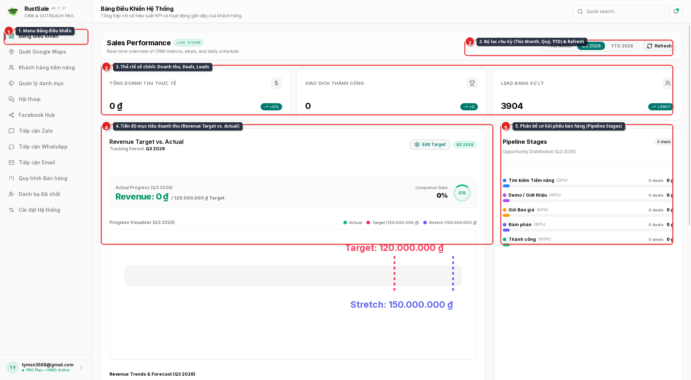

# 📊 Hướng Dẫn Sử Dụng: Bảng Điều Khiển Hệ Thống (Dashboard)

> 💡 **Tổng quan:** **Bảng Điều Khiển Hệ Thống (Dashboard)** là trung tâm chỉ huy số liệu kinh doanh của **RustSale CRM & Outreach Pro**, giúp ban giám đốc và nhân viên bán hàng theo dõi sát sao doanh thu thực tế, số lượng hợp đồng chốt thành công, và tiến độ hoàn thành chỉ tiêu doanh số theo thời gian thực.

---

## 📸 Giao Diện Bảng Điều Khiển Tổng Quan

---

## 📌 Hướng Dẫn Thao Tác Chi Tiết

### ❶ Menu Điều Hướng "Bảng Điều Khiển" (Sidebar)
* **Vị trí:** Mục đầu tiên trên thanh menu bên trái.
* **Tác vụ:** Nhấp vào để quay về màn hình phân tích hiệu suất bán hàng bất cứ khi nào.

---

### ❷ Bộ Lọc Chu Kỳ Thời Gian & Làm Mới Dữ Liệu
* **Bộ lọc chu kỳ (`Time Filter`):**
  * **This Month:** Xem thống kê doanh thu và cơ hội của tháng hiện tại.
  * **Q3 2026 (Theo Quý):** Thống kê theo quý kinh doanh để đối chiếu kế hoạch năm.
  * **YTD 2026 (Year to Date):** Xem số liệu lũy kế từ đầu năm đến nay.
* **Nút Làm mới (`Refresh`):** Đồng bộ các giao dịch mới nhất từ hệ thống mà không cần tải lại app.

---

### ❸ Thẻ Chỉ Số Tổng Quan (Core KPIs)
* **Tổng Doanh Thu Thực Tế:** Tổng giá trị bằng VNĐ của toàn bộ các giao dịch đã hoàn tất thanh toán.
* **Giao Dịch Thành Công:** Số lượng khách hàng đã ký hợp đồng hoặc chuyển sang giai đoạn Won.
* **Lead Đang Xử Lý:** Tổng số lượng data khách hàng tiềm năng đang có trong hệ thống chờ đội ngũ kinh doanh tiếp cận.

---

### ❹ Tiến Độ Mục Tiêu Doanh Thu (Revenue Target vs. Actual)
* **Mục tiêu quý (`Target`):** Vạch chỉ tiêu đặt ra (Ví dụ: `120.000.000 đ`).
* **Tỷ lệ hoàn thành (`Completion Rate`):** Biểu đồ tròn phần trăm hoàn thành chỉ tiêu.
* **Mục tiêu bứt phá (`Stretch Target`):** Mốc thưởng nâng cao cho đội ngũ (Ví dụ: `150.000.000 đ`).
* **Nút `Edit Target`:** Cho phép điều chỉnh mục tiêu doanh số nhanh chóng.

---

### ❺ Phân Bổ Cơ Hội Theo Phễu Bán Hàng (Pipeline Stages)
Hiển thị số lượng giao dịch và tổng giá trị tiền đang nằm tại từng nấc của quy trình bán hàng:
* **Tìm kiếm Tiềm năng (20% xác suất thành công)**
* **Demo / Giới thiệu sản phẩm (40%)**
* **Gửi Báo giá (60%)**
* **Đàm phán (80%)**
* **Thành công (100%)**

---

> [!TIP]
> **Mẹo quản lý:** Bắt đầu ngày làm việc bằng việc kiểm tra tỷ lệ rơi rụng ở mục **Pipeline Stages** để giao việc tập trung xử lý các cơ hội đang ở bước "Gửi báo giá" và "Đàm phán".
