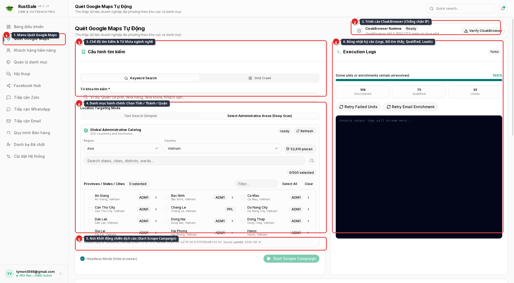

# 🗺️ Hướng Dẫn Sử Dụng: Quét Dữ Liệu Tự Động Google Maps (Lead Scraper)

> 💡 **Tổng quan:** Công cụ **Google Maps Scraper** được trang bị công nghệ **CloakBrowser Runtime** giúp bạn tự động thu thập hàng ngàn thông tin khách hàng doanh nghiệp, cửa hàng, phòng khám, spa theo từng khu vực địa lý và ngành nghề mục tiêu với độ chính xác cao và an toàn tuyệt đối.

---

## 📸 Giao Diện Quét Dữ Liệu Google Maps

---

## 📌 Hướng Dẫn Thao Tác Chi Tiết

### ❶ Menu Điều Hướng "Quét Google Maps" (Sidebar)
* Nhấp vào mục thứ 2 trên thanh menu để mở trung tâm thu thập dữ liệu doanh nghiệp.

---

### ❷ Trình Cào Chống Chặn IP (CloakBrowser Runtime)
* **Trạng thái (`Ready`):** Báo hiệu môi trường cào giả lập thiết bị thật đã sẵn sàng (Ví dụ: `CloakBrowser 146.0 ready on linux-x64`).
* **Nút `Verify CloakBrowser`:** Kiểm tra tính toàn vẹn của nhân trình duyệt ẩn danh để bảo vệ địa chỉ IP của bạn không bị Google giới hạn.

---

### ❸ Cấu Hình Tìm Kiếm & Từ Khóa Ngành Nghề
* **Chế độ tìm kiếm:**
  * **Keyword Search:** Tìm kiếm nhanh theo cụm từ khóa (Quán cà phê, Nha khoa, Khách sạn, Spa...).
  * **Grid Crawl:** Cào sâu theo mạng lưới tọa độ ô bàn cờ bao phủ toàn bộ bán kính khu vực.
* **Ô nhập `Từ khóa tìm kiếm *`:** Nhập tên dịch vụ hoặc ngành hàng muốn quét (Ví dụ: `Vật lý trị liệu`, `Spa chăm sóc da`).

---

### ❹ Danh Mục Hành Chính: Chọn Tỉnh / Thành / Quận
* **Hệ thống dữ liệu hành chính (`Global Administrative Catalog`):**
  * Tích hợp sẵn 63 Tỉnh/Thành phố và toàn bộ Quận/Huyện, Phường/Xã tại Việt Nam.
  * Hỗ trợ tìm kiếm nhanh theo ô: `Search states, cities, districts, wards...`.
* **Lựa chọn khu vực mục tiêu:**
  * Chọn từng tỉnh thành (Ví dụ: Hà Nội, TP. Hồ Chí Minh, Đà Nẵng, Cần Thơ...).
  * Cho phép chọn tối đa 500 phân vùng trong một chiến dịch quét.

---

### ❺ Thiết Lập Vận Hành & Khởi Động Chiến Dịch
* **Chế độ chạy ngầm (`Headless Mode`):** Ẩn hoàn toàn cửa sổ trình duyệt để tiết kiệm RAM và CPU tối đa.
* **Nút `Start Scrape Campaign` (Màu xanh ngọc):** Bấm để bắt đầu tự động quét và thu thập danh bạ.

---

### ❻ Bảng Nhật Ký Cào & Tiến Độ (Execution Logs)
* **Thống kê theo thời gian thực:**
  * **Discovered (Đã tìm thấy):** Tổng số địa điểm được Google Maps trả về.
  * **Qualified (Hợp lệ):** Địa điểm có đầy đủ số điện thoại và thông tin liên lạc.
  * **Leads:** Số lượng khách hàng tiềm năng đã được tự động lưu vào hệ thống CRM.
* **Màn hình Console Log đen:** Hiển thị chi tiết từng địa điểm đang được quét.
* **Nút xử lý lại:**
  * `Retry Failed Units`: Thử lại các đơn vị quét bị gián đoạn.
  * `Retry Email Enrichment`: Tự động tìm kiếm thêm email cho các doanh nghiệp chưa có email.

---

> [!TIP]
> **Kinh nghiệm cào data:** Khi quét các thành phố lớn như TP.HCM hoặc Hà Nội, hãy chọn chi tiết theo từng Quận/Huyện để Google Maps không bị giới hạn 120 kết quả hiển thị cho mỗi truy vấn.
