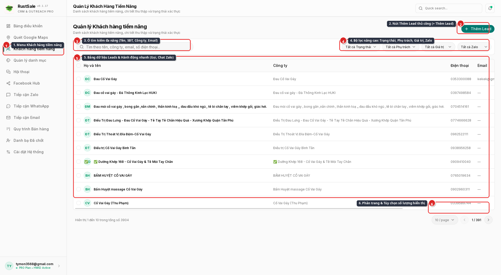

# 👥 Hướng Dẫn Sử Dụng: Quản Lý Khách Hàng Tiềm Năng (Leads)

> 💡 **Tổng quan:** Phân hệ **Khách Hàng Tiềm Năng (Leads Management)** là nơi lưu trữ, phân loại và sàng lọc toàn bộ dữ liệu khách hàng được cào về từ Google Maps, Facebook hoặc nhập thủ công. Tại đây bạn có thể lọc nhanh danh bạ Zalo, kích hoạt chiến dịch tiếp cận và phân chia cho nhân viên tư vấn.

---

## 📸 Giao Diện Quản Lý Khách Hàng Tiềm Năng

---

## 📌 Hướng Dẫn Thao Tác Chi Tiết

### ❶ Menu Điều Hướng "Khách Hàng Tiềm Năng"
* Nhấp vào mục thứ 3 trên sidebar để mở danh sách toàn bộ khách hàng tiềm năng trong hệ thống.

---

### ❷ Thêm Mới Khách Hàng Thủ Công
* **Nút `+ Thêm Lead` (Góc trên bên phải):**
  * Nhấp vào để mở form thêm khách hàng mới khi có khách liên hệ trực tiếp ngoài luồng cào tự động.
  * Nhập: Họ tên, Tên doanh nghiệp/cửa hàng, Số điện thoại, Email, Địa chỉ và ghi chú nhu cầu.

---

### ❸ Thanh Tìm Kiếm Đa Năng
* **Ô tìm kiếm (`Search input`):** Tìm kiếm tức thì theo:
  * Tên khách hàng / Chủ cơ sở.
  * Tên công ty / Cửa hàng.
  * Số điện thoại liên hệ.
  * Địa chỉ email.

---

### ❹ Bộ Lọc Dữ Liệu Nâng Cao
Giúp chia tách tệp dữ liệu lớn (3900+ khách) thành các nhóm mục tiêu nhỏ:
* **Tất cả Trạng thái:** Lọc khách hàng Mới (New), Đang liên hệ (Contacted), Quan tâm (Interested), v.v.
* **Tất cả Phụ trách:** Lọc theo nhân viên kinh doanh được chỉ định phụ trách.
* **Tất cả Giá trị:** Phân khúc theo quy mô hợp đồng dự kiến.
* **Tất cả Zalo:** **Rất quan trọng!** Lọc riêng các số điện thoại đã được hệ thống xác thực là **Có Zalo** để chuẩn bị chạy chiến dịch gửi tin nhắn tự động.

---

### ❺ Bảng Dữ Liệu Leads & Thao Tác Nhanh
* **Các trường thông tin hiển thị:**
  * Checkbox chọn hàng loạt (để xóa, chuyển giai đoạn hoặc gắn tag).
  * Huy hiệu Avatar chữ viết tắt kèm màu sắc nhận diện.
  * **Họ và tên / Tên dịch vụ:** Ví dụ: *Đau Cổ Vai Gáy, Bấm Huyệt Massage...*
  * **Công ty:** Tên cơ sở kinh doanh.
  * **Điện thoại:** Số hotline hoặc di động.
  * **Email:** Địa chỉ thư điện tử doanh nghiệp.
* **Tương tác trực tiếp:** Nhấp chuột vào bất kỳ dòng khách hàng nào để mở chi tiết lịch sử chăm sóc hoặc chuyển thẳng vào phòng chat Hội thoại.

---

### ❻ Quản Lý Phân Trang Dữ Liệu
* Hiển thị tổng số data hiện có (Ví dụ: `Hiển thị 1 đến 10 trong tổng số 3904`).
* Cho phép chọn số dòng trên 1 trang: `10 / page`, `25 / page`, `50 / page`, `100 / page`.
* Nút chuyển trang trước / sau và số trang hiện tại (`1 / 391`).

---

> [!TIP]
> **Quy trình chuẩn:** Sau khi cào xong 1 mảng Google Maps, hãy vào mục này, chọn bộ lọc **Tất cả Zalo -> Có Zalo**, sau đó chọn tất cả và thêm vào chiến dịch Tiếp cận Zalo để bắt đầu tư vấn.
