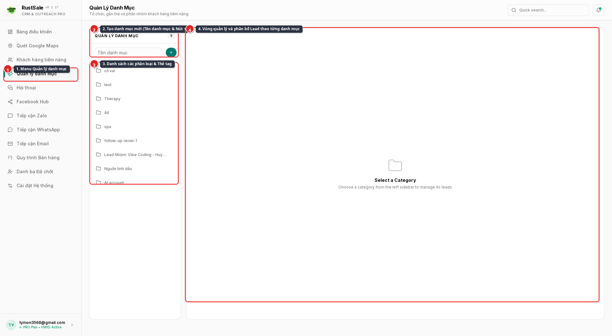

# 🏷️ Hướng Dẫn Sử Dụng: Quản Lý Danh Mục & Thẻ Tag (Category Manager)

> 💡 **Tổng quan:** Phân hệ **Quản Lý Danh Mục (Category Manager)** giúp bạn cấu trúc và phân loại tệp khách hàng khoa học theo ngành nghề, nguồn thu thập hoặc giai đoạn chiến dịch (Ví dụ: *Spa, Khách sạn, Trị liệu, Nhóm Zalo...*).

---

## 📸 Giao Diện Quản Lý Danh Mục

---

## 📌 Hướng Dẫn Thao Tác Chi Tiết

### ❶ Menu Điều Hướng "Quản Lý Danh Mục"
* Nhấp vào mục thứ 4 trên sidebar để mở bảng quản lý danh mục và nhóm khách hàng.

---

### ❷ Tạo Danh Mục Khách Hàng Mới
* **Ô nhập `Tên danh mục`:** Nhập tên nhóm bạn muốn tạo (Ví dụ: `Khách sạn Quận 1`, `Nha khoa Hà Nội`, `Khách VIP Zalo`).
* **Nút `+` (Màu xanh ngọc):** Bấm để khởi tạo danh mục mới vào hệ thống ngay tức khắc.

---

### ❸ Danh Sách Các Danh Mục Đã Tạo
* Hiển thị danh mục theo dạng cây thư mục trực quan kèm số lượng danh mục hiện có (Ví dụ: `QUẢN LÝ DANH MỤC (9)`):
  * 📁 `cổ vai`
  * 📁 `test`
  * 📁 `Therapy`
  * 📁 `All`
  * 📁 `spa`
  * 📁 `follow-up-level-1`
  * 📁 `Lead Nhóm: Vibe Coding - Huy...`
  * 📁 `Nguồn tinh dầu`
  * 📁 `AI account`
* Mỗi danh mục là một tệp khách hàng độc lập phục vụ cho các chiến dịch gửi tin mục tiêu riêng biệt.

---

### ❹ Vùng Quản Lý Chi Tiết Lead Thuộc Danh Mục
* **Cách sử dụng:** Nhấp vào bất kỳ danh mục nào ở cột bên trái.
* Cột bên phải sẽ tự động hiển thị danh sách toàn bộ khách hàng nằm trong danh mục đó, kèm tùy chọn thêm mới, xóa hoặc chuyển khách sang danh mục khác.

---

> [!TIP]
> **Chiến lược phân nhóm hiệu quả:** Hãy đặt tên danh mục theo công thức: `[Nguồn] - [Ngành Nghề] - [Khu Vực]` (Ví dụ: `GMaps - Nha Khoa - DaNang`). Cách đặt tên này giúp bạn dễ dàng chọn tệp khi thiết lập chiến dịch tiếp cận tự động.
