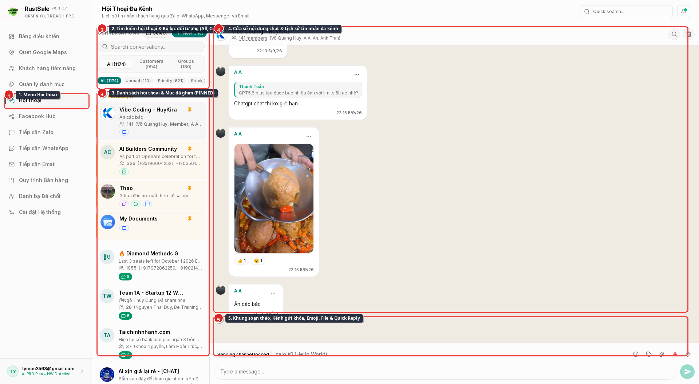

# 💬 Hướng Dẫn Sử Dụng: Hội Thoại Đa Kênh (Omnichannel Inbox)

> 💡 **Tổng quan:** Tính năng **Hội Thoại Đa Kênh** trên **RustSale CRM & Outreach Pro** giúp bạn hợp nhất toàn bộ tin nhắn từ nhiều tài khoản và nền tảng (Zalo cá nhân, Zalo OA, WhatsApp, Facebook Messenger, Email) về một giao diện duy nhất để chăm sóc khách hàng tập trung, phản hồi tức thì và không bỏ sót khách hàng tiềm năng.

---

## 📸 Giao Diện Hội Thoại Đa Kênh

---

## 📌 Hướng Dẫn Thao Tác Chi Tiết

### ❶ Menu Điều Hướng "Hội Thoại" (Sidebar)
* Nhấp vào mục **Hội thoại** trên sidebar để mở trung tâm nhắn tin hợp nhất.

---

### ❷ Bộ Lọc & Tìm Kiếm Cuộc Trò Chuyện
* **🔍 Ô tìm kiếm (`Search conversations...`):** Tìm theo tên khách hàng, số điện thoại hoặc từ khóa nội dung tin nhắn.
* **Tabs phân loại:**
  * **All:** Toàn bộ cuộc hội thoại.
  * **Customers:** Khách hàng cá nhân / khách hàng tiềm năng.
  * **Groups:** Các nhóm chat Zalo/WhatsApp nhiều thành viên.
* **Tags trạng thái:**
  * **Unread:** Tin nhắn mới chưa đọc.
  * **Priority:** Khách hàng ưu tiên chăm sóc.
  * **Stuck:** Khách hàng bị nghẽn cần hỗ trợ khẩn cấp.

---

### ❸ Danh Sách Cuộc Trò Chuyện & Ghim (PINNED)
* **Mục PINNED:** Ghim cố định các nhóm VIP hoặc khách hàng trọng điểm lên hàng đầu.
* **Thông báo tin mới:** Huy hiệu số màu xanh đếm số tin chưa đọc (Ví dụ: `9`).
* Hiển thị kèm avatar, tên người gửi và đoạn trích tin nhắn gần nhất.

---

### ❹ Cửa Sổ Nội Dung Chat & Lịch Sử Trao Đổi
* **Header:** Hiển thị tên khách hàng/nhóm, số thành viên, nút tìm kiếm tin nhắn và nút lưu trữ/xóa.
* **Luồng tin nhắn:** Hiển thị bong bóng chat sinh động, hỗ trợ hình ảnh, liên kết, tin nhắn thoại, tin nhắn trích dẫn (quote reply).

---

### ❺ Khung Soạn Thảo & Gửi Tin Đa Kênh
* **Khóa kênh gửi (`Sending channel locked`):** Báo rõ kênh và tài khoản đang gửi (Ví dụ: `zalo #1 (Hello World)`).
* **Ô soạn thảo tin nhắn:** Gõ văn bản tự do, hỗ trợ Emoji sinh động.
* **Công cụ bổ trợ:**
  * 🏷️ **Gắn thẻ khách:** Phân loại khách ngay trong lúc tư vấn.
  * 📎 **Đính kèm tài liệu:** Gửi file báo giá PDF, ảnh sản phẩm.
  * 🎙️ **Voice message:** Ghi âm trực tiếp.
  * ⚡ **Tin nhắn mẫu (Quick Reply):** Bấm phím tắt để chèn nhanh câu trả lời mẫu.
  * ➤ **Nút Gửi:** Chuyển tin nhắn đến khách ngay lập tức.

---

> [!TIP]
> **Phím tắt hữu ích:** Bấm `Shift + Enter` để xuống dòng trong khung chat, và `Enter` để gửi tin nhanh.
