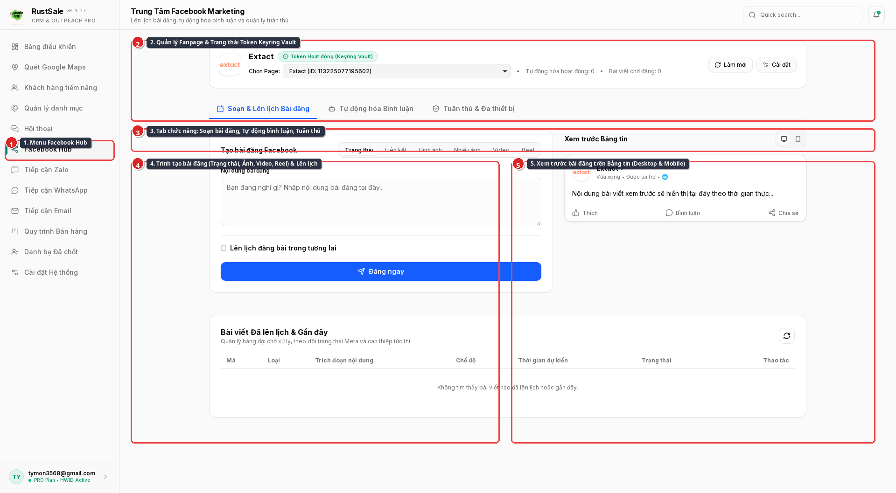

# 🌐 Hướng Dẫn Sử Dụng: Facebook Hub (Quản Trị Fanpage & Tự Động Hóa)

> 💡 **Tổng quan:** **Facebook Hub** là trung tâm điều hành Fanpage và Group Facebook của **RustSale Pro**, cho phép bạn kết nối token an toàn qua **Keyring Vault**, soạn thảo và lên lịch bài viết đa định dạng, tự động hóa trả lời bình luận và nhắn tin cho khách hàng tương tác trên bài viết.

---

## 📸 Giao Diện Facebook Hub

---

## 📌 Hướng Dẫn Thao Tác Chi Tiết

### ❶ Menu Điều Hướng "Facebook Hub"
* Nhấp vào mục thứ 6 trên sidebar để truy cập trung tâm tiếp thị Facebook.

---

### ❷ Quản Lý Fanpage & Trạng Thái Token
* **Thông tin Page liên kết:** Hiển thị Logo, Tên Fanpage (Ví dụ: `Extact`) và Page ID (`113225077195602`).
* **Huy hiệu bảo mật (`Token Hoạt động - Keyring Vault`):** Xác thực mã Access Token của Facebook đang hoạt động ổn định và được mã hóa lưu trữ an toàn trong nhân hệ điều hành.
* **Dropdown `Chọn Page`:** Cho phép chuyển đổi linh hoạt giữa nhiều Fanpage khác nhau mà bạn đang quản lý.

---

### ❸ Các Tab Chức Năng Chính
* **📅 Soạn & Lên lịch Bài đăng:** Tạo nội dung, đính kèm media và hẹn giờ phát bài tự động.
* **🤖 Tự động hóa Bình luận:** Thiết lập kịch bản tự động phản hồi comment của khách hàng và tự động gửi tin nhắn Messenger riêng tư cho khách comment hỏi giá.
* **🛡️ Tuân thủ & Đa thiết bị:** Cấu hình thời gian giãn cách giữa các bài đăng và bình luận để tuân thủ thuật toán chống spam của Meta.

---

### ❹ Trình Tạo Bài Đăng Facebook & Lên Lịch
* **Chọn loại bài đăng:**
  * **Trạng thái:** Bài viết thuần văn bản.
  * **Liên kết:** Bài viết chia sẻ link bài báo hoặc website bán hàng.
  * **Hình ảnh / Nhiều ảnh:** Đăng bộ sưu tập ảnh sản phẩm.
  * **Video:** Đăng video clip review sản phẩm.
  * **Reel:** Đăng video ngắn dạng thước phim Facebook Reel để tiếp cận hàng triệu lượt xem tự nhiên.
* **Khung soạn nội dung:** `Bạn đang nghĩ gì? Nhập nội dung bài đăng tại đây...` hỗ trợ chèn hashtag, icon và biến số cá nhân hóa.

---

### ❺ Xem Trước Bài Đăng Trên Bảng Tin (Feed Preview)
* **Mô phỏng thời gian thực:** Xem trước giao diện bài viết hiển thị trên Bảng tin Facebook của khách hàng ngay trong lúc gõ phím.
* **Chuyển đổi giao diện:** Nút chuyển đổi giữa chế độ hiển thị trên **Máy tính (Desktop 🖥️)** và **Điện thoại (Mobile 📱)** để đảm bảo hình ảnh không bị cắt méo.

---

> [!TIP]
> **Chiến lược kéo khách:** Kết hợp đăng bài dạng **Reel** kèm tính năng **Tự động hóa Bình luận** (Khách comment "Nhận giá" -> bot tự động inbox báo giá chi tiết qua Messenger).
