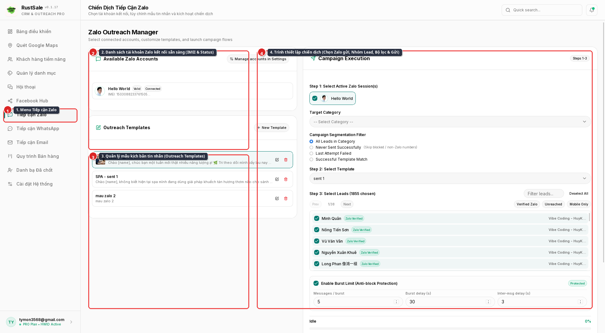

# 📱 Hướng Dẫn Sử Dụng: Tiếp Cận Khách Hàng Zalo (Zalo Outreach Manager)

> 💡 **Tổng quan:** **Zalo Outreach Manager** là vũ khí bán hàng mạnh mẽ nhất của **RustSale Pro**, cho phép bạn gửi tin nhắn tiếp cận hàng loạt tới danh sách số điện thoại khách hàng tiềm năng với công nghệ **Burst Limit chống khóa tài khoản** và kịch bản biến thể động **Spintax**.

---

## 📸 Giao Diện Quản Lý Tiếp Cận Zalo

---

## 📌 Hướng Dẫn Thao Tác Chi Tiết

### ❶ Menu Điều Hướng "Tiếp Cận Zalo"
* Nhấp vào mục thứ 7 trên sidebar để mở trung tâm thiết lập chiến dịch gửi tin nhắn Zalo.

---

### ❷ Danh Sách Tài Khoản Zalo Kết Nối (Available Accounts)
* Hiển thị avatar, tên Zalo đang kết nối (Ví dụ: `Hello World`), trạng thái `Valid`, `Connected` và chuỗi IMEI phần cứng của phiên đăng nhập.
* **Nút `Manage accounts in Settings`:** Nhảy nhanh đến trang cài đặt để quét mã QR đăng nhập thêm tài khoản Zalo mới.

---

### ❸ Quản Lý Mẫu Kịch Bản Tin Nhắn (Outreach Templates)
* **Nút `+ New Template`:** Tạo mẫu kịch bản tin nhắn tiếp cận mới.
* **Danh sách mẫu đã tạo:**
  * Hỗ trợ gửi tin nhắn kèm hình ảnh banner (`sent 1`, `SPA - sent 1`...).
  * Cho phép sửa đổi nội dung hoặc xóa mẫu bất cứ lúc nào.
  * Hỗ trợ biến số động: `{name}` (Tên khách), `{company}` (Tên cơ sở kinh doanh).

---

### ❹ Trình Thiết Lập Chiến Dịch Gửi Tin (Campaign Execution)
Quy trình 3 bước gửi tin chuẩn mực:
* **Step 1: Chọn tài khoản Zalo gửi:** Tích chọn tài khoản Zalo sẽ thực hiện gửi tin.
* **Target Category (Chọn tệp khách hàng):** Chọn danh mục khách hàng mục tiêu đã cào từ Google Maps (Ví dụ: `spa`, `cổ vai`).
* **Campaign Segmentation Filter (Bộ lọc phân khúc):**
  * `All Leads in Category`: Gửi cho toàn bộ khách trong nhóm.
  * `Never Sent Successfully`: Chỉ gửi cho khách chưa từng gửi thành công (Tự động bỏ qua các số bị chặn hoặc không dùng Zalo).
  * `Last Attempt Failed`: Thử gửi lại cho các số lần trước bị lỗi mạng.
* **Step 2: Chọn mẫu kịch bản tin nhắn:** Chọn template kịch bản đã soạn sẵn.
* **Step 3: Chọn danh sách Leads:** Duyệt qua danh sách số điện thoại có nhãn xanh `Zalo Verified`.
* **Cơ chế Chống Khóa Tài Khoản (`Enable Burst Limit`):**
  * **Messages / burst:** Số lượng tin gửi trong một đợt (Khuyến nghị: `5` tin).
  * **Burst delay (s):** Thời gian nghỉ giữa các đợt (Khuyến nghị: `30` giây).
  * **Inter-msg delay (s):** Độ trễ ngẫu nhiên giữa 2 tin nhắn liên tiếp (Khuyến nghị: `3` đến `8` giây).

---

> [!WARNING]
> **Lưu ý bảo vệ tài khoản Zalo:** Không nên gửi quá 100 tin nhắn cho người lạ mỗi ngày trên một tài khoản Zalo cá nhân. Hãy luôn bật tính năng **Enable Burst Limit** để bảo vệ tài khoản vĩnh viễn.
