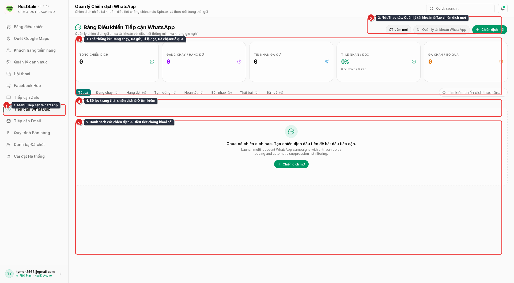

# 💬 Hướng Dẫn Sử Dụng: Tiếp Cận Khách Hàng WhatsApp (WhatsApp Marketing)

> 💡 **Tổng quan:** Phân hệ **Tiếp Cận WhatsApp** giúp doanh nghiệp tiếp cận khách hàng quốc tế và đối tác xuất nhập khẩu thông qua chiến dịch gửi tin nhắn WhatsApp Marketing hàng loạt, có điều tiết tốc độ thông minh và khung giờ nghỉ ngơi để tránh vi phạm chính sách của Meta.

---

## 📸 Giao Diện Tiếp Cận WhatsApp

---

## 📌 Hướng Dẫn Thao Tác Chi Tiết

### ❶ Menu Điều Hướng "Tiếp Cận WhatsApp"
* Nhấp vào mục thứ 8 trên sidebar để mở bảng điều khiển chiến dịch WhatsApp.

---

### ❷ Thanh Công Cụ & Thao Tác Nhanh
* **Nút `Làm mới`:** Cập nhật tức thời tiến độ gửi tin và phản hồi của khách.
* **Nút `Quản lý tài khoản WhatsApp`:** Đăng nhập và quản lý các số điện thoại WhatsApp kết nối.
* **Nút `+ Chiến dịch mới` (Màu xanh ngọc):** Mở trình tạo chiến dịch tiếp thị WhatsApp hàng loạt.

---

### ❸ Các Thẻ Thống Kê Hiệu Suất Chiến Dịch
Cung cấp bức tranh toàn cảnh về hiệu quả tiếp cận:
* **TỔNG CHIẾN DỊCH:** Tổng số chiến dịch đã được khởi tạo.
* **ĐANG CHẠY / HÀNG ĐỢI:** Số lượng chiến dịch đang trong tiến trình phát tin nhắn.
* **TIN NHẮN ĐÃ GỬI:** Số lượng tin đã gửi đi thành công tới thiết bị khách.
* **TỈ LỆ NHẬN / ĐỌC (%):** Phần trăm khách hàng đã mở đọc tin nhắn (Read Receipt).
* **ĐÃ CHẶN / BỎ QUA:** Số lượng liên hệ từ chối nhận tin để tự động đưa vào danh sách đen (Suppression List).

---

### ❹ Bộ Lọc Trạng Thái & Quản Lý Chiến Dịch
* Cho phép lọc nhanh danh sách theo các trạng thái:
  * `Tất cả` | `Đang chạy` | `Hàng đợi` | `Tạm dừng` | `Hoàn tất` | `Bản nháp` | `Thất bại` | `Đã huỷ`
* Ô tìm kiếm tên chiến dịch giúp tra cứu lịch sử tiếp thị dễ dàng.

---

### ❺ Cơ Chế Bảo Vệ Chống Khóa Số (Anti-Ban Engine)
* Tự động điều tiết khoảng nghỉ ngơi (Pacing delay).
* Tự động lọc các số không tồn tại WhatsApp trước khi gửi để giữ uy tín tài khoản ở mức cao nhất.

---

> [!TIP]
> **Chiến lược gửi tin:** Chỉ gửi tin nhắn trong khung giờ làm việc (8h30 - 11h30 và 14h00 - 17h00) để đạt tỷ lệ mở đọc và phản hồi cao nhất.
