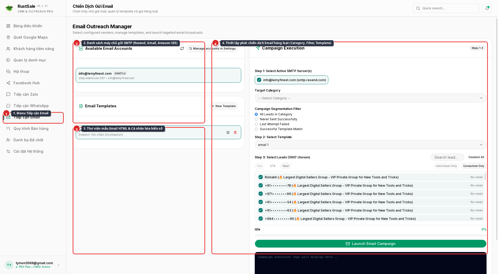

# ✉️ Hướng Dẫn Sử Dụng: Tiếp Cận Khách Hàng Email (Cold Email Outreach)

> 💡 **Tổng quan:** **Email Outreach Manager** cho phép bạn gửi hàng ngàn bức thư chào hàng và báo giá chuyên nghiệp thông qua các máy chủ gửi thư tiêu chuẩn cao (Resend, Amazon SES, Google Workspace, SMTP riêng) với tỷ lệ vào hộp thư chính (Inbox) cao vượt trội.

---

## 📸 Giao Diện Tiếp Cận Email

---

## 📌 Hướng Dẫn Thao Tác Chi Tiết

### ❶ Menu Điều Hướng "Tiếp Cận Email"
* Nhấp vào mục thứ 9 trên thanh điều hướng bên trái để vào trung tâm tiếp thị Email.

---

### ❷ Danh Sách Máy Chủ Gửi Email (Available Email Accounts)
* Hiển thị địa chỉ email gửi thư (Ví dụ: `info@lemyfinest.com`), giao thức mã hóa `STARTTLS`, cổng máy chủ `smtp.resend.com:587`.
* **Nút `Manage accounts in Settings`:** Cấu hình thông số SMTP, SPF, DKIM để thư không bao giờ bị đánh dấu là Spam.

---

### ❸ Thư Viện Mẫu Email (Email Templates)
* **Nút `+ New Template`:** Soạn thảo email chào hàng mới với giao diện HTML hoặc văn bản phong phú.
* Hỗ trợ chèn tiêu đề thư hấp dẫn (Subject: `Xin chào {{company}}`).
* Hỗ trợ các thẻ cá nhân hóa dữ liệu:
  * `{{name}}`: Tên người đại diện doanh nghiệp.
  * `{{company}}`: Tên công ty hoặc cửa hàng.
  * `{{phone}}`: Số điện thoại của khách.

---

### ❹ Trình Thiết Lập Phát Chiến Dịch Email (Campaign Execution)
* **Step 1: Chọn SMTP Server:** Chọn hộp thư đại diện công ty để gửi đi.
* **Target Category:** Chọn tệp khách hàng có sẵn địa chỉ email trong danh bạ.
* **Campaign Segmentation Filter:**
  * Chỉ gửi cho khách chưa từng nhận thư (`Never Sent Successfully`).
  * Gửi lại cho khách bị lỗi hòm thư (`Last Attempt Failed`).
* **Step 2: Chọn mẫu thư:** Lựa chọn kịch bản email muốn truyền tải.
* Bấm **Gửi chiến dịch** để hệ thống tự động phát tán email tuần tự theo hàng đợi.

---

> [!TIP]
> **Kinh nghiệm viết Cold Email:** Tiêu đề thư càng ngắn gọn và mang tính cá nhân càng có tỷ lệ mở cao (Ví dụ: *"Hợp tác cùng {{company}} tháng này"* thay vì *"THƯ BÁO GIÁ DỊCH VỤ CÔNG TY ABC"*).
