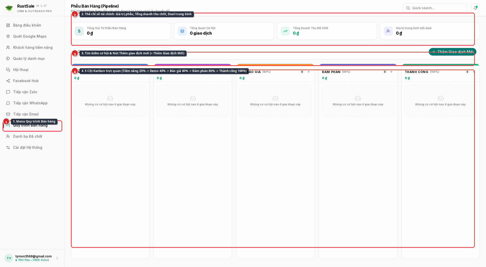

# 📋 Hướng Dẫn Sử Dụng: Quy Trình Bán Hàng Kanban (Sales Pipeline)

> 💡 **Tổng quan:** Bảng **Kanban Quy Trình Bán Hàng** giúp trực quan hóa toàn bộ hành trình chuyển đổi một khách hàng tiềm năng thành hợp đồng thanh toán thành công, hỗ trợ kéo thả (Drag & Drop) mượt mà giữa các nấc thương thảo.

---

## 📸 Giao Diện Bảng Kanban Quy Trình Bán Hàng

---

## 📌 Hướng Dẫn Thao Tác Chi Tiết

### ❶ Menu Điều Hướng "Quy Trình Bán Hàng"
* Nhấp vào mục thứ 10 trên sidebar để mở bảng quản trị cơ hội bán hàng Kanban.

---

### ❷ Thẻ Chỉ Số Tài Chính Của Phễu (Deal Metrics)
* **Tổng Giá Trị Phễu Bán Hàng:** Tổng lượng tiền của toàn bộ các cơ hội đang có trong quy trình.
* **Tổng Quan Cơ Hội:** Tổng số lượng deal đang được nhân viên đàm phán (Ví dụ: `0 giao dịch`).
* **Tổng Doanh Thu Đã Chốt:** Tổng số tiền đã thu thành công từ các hợp đồng hoàn tất.
* **Giá Trị Trung Bình Mỗi Deal:** Quy mô doanh thu trung bình của một khách hàng.

---

### ❸ Tìm Kiếm Giao Dịch & Tạo Deal Mới
* **Ô tìm kiếm:** Tìm nhanh theo tiêu đề giao dịch, tên người liên hệ hoặc tên công ty.
* **Nút `+ Thêm Giao dịch Mới` (Màu xanh ngọc):** Tạo một cơ hội bán hàng mới, gán giá trị hợp đồng và chỉ định nhân viên phụ trách.

---

### ❹ 5 Cột Phễu Bán Hàng Trực Quan
Kéo thả thẻ giao dịch qua từng cột theo tiến độ thực tế:
1. **🔵 TÌM KIẾM TIỀM NĂNG (Xác suất 20%):** Khách hàng mới được chuyển từ mục Leads sang, vừa bắt đầu liên hệ tiếp cận.
2. **🟣 DEMO / GIỚI THIỆU (Xác suất 40%):** Khách hàng đã đồng ý nghe tư vấn, xem bản giới thiệu hoặc trải nghiệm sản phẩm thử.
3. **🟠 GỬI BÁO GIÁ (Xác suất 60%):** Đã gửi bảng báo giá chi tiết và phương án triển khai cho khách.
4. **🔵 ĐÀM PHÁN (Xác suất 80%):** Đang thương thảo điều khoản hợp đồng, chiết khấu hoặc phương thức thanh toán.
5. **🟢 THÀNH CÔNG (Xác suất 100%):** Hợp đồng đã ký, tiền đã về tài khoản. Khi kéo vào cột này, khách sẽ tự động được lưu vào **Danh Bạ Đã Chốt**.

---

> [!TIP]
> **Thao tác nhanh:** Bấm vào biểu tượng dấu `+` nhỏ ở góc phải đầu mỗi cột để tạo nhanh một giao dịch trực tiếp ngay tại nấc giai đoạn đó.
