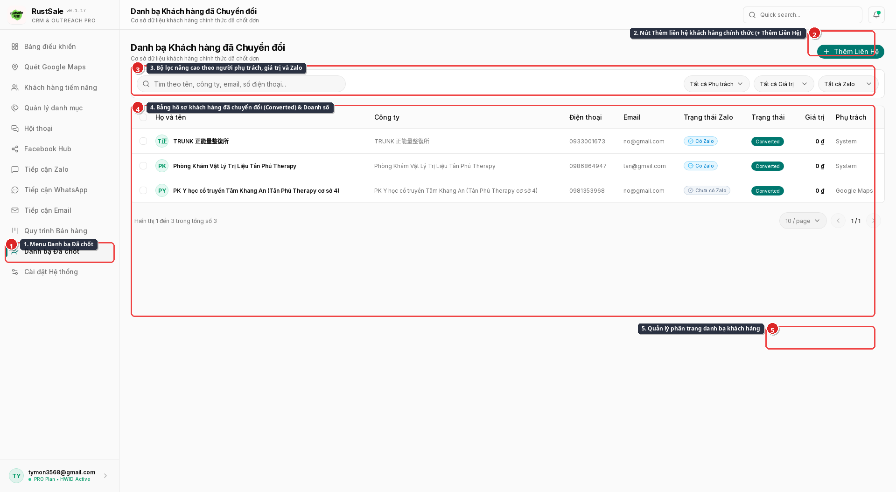

# 🏆 Hướng Dẫn Sử Dụng: Danh Bạ Khách Hàng Đã Chốt (Won Contacts)

> 💡 **Tổng quan:** **Danh Bạ Khách Hàng Đã Chốt (Won Contacts)** là kho tài sản quý giá nhất của doanh nghiệp, lưu trữ thông tin của toàn bộ các khách hàng đã từng mua hàng hoặc ký hợp đồng thành công để phục vụ chăm sóc sau bán và bán thêm (Upsell/Cross-sell).

---

## 📸 Giao Diện Danh Bạ Khách Hàng Đã Chốt

---

## 📌 Hướng Dẫn Thao Tác Chi Tiết

### ❶ Menu Điều Hướng "Danh Bạ Đã Chốt"
* Nhấp vào mục thứ 11 trên sidebar để xem toàn bộ danh bạ khách hàng chuyển đổi chính thức.

---

### ❷ Thêm Khách Hàng Chốt Đơn Thủ Công
* **Nút `+ Thêm Liên Hệ`:** Dành cho các khách hàng thanh toán trực tiếp tại văn phòng hoặc qua đối tác giới thiệu để đưa ngay vào danh sách khách hàng chính thức.

---

### ❸ Bộ Lọc Chăm Sóc Khách Hàng Cũ
* **Tất cả Phụ trách:** Lọc theo nhân viên chăm sóc tài khoản (Account Manager/CSKH).
* **Tất cả Giá trị:** Phân hạng khách hàng theo giá trị đã chi tiêu (VIP, Trung bình, Nhỏ).
* **Tất cả Zalo:** Kiểm tra tài khoản Zalo của khách để gửi tin nhắn chúc mừng sinh nhật, thông báo ưu đãi hoặc lịch bảo trì.

---

### ❹ Bảng Hồ Sơ Khách Hàng Đã Chuyển Đổi (Converted)
* **Họ và tên & Avatar:** Tên người đại diện doanh nghiệp hoặc cá nhân.
* **Công ty:** Tên doanh nghiệp (Ví dụ: `TRUNK 正能量整復所`, `Phòng Khám Vật Lý Trị Liệu Tân Phú Therapy`...).
* **Điện thoại & Email:** Kênh liên lạc chính thức.
* **Trạng thái Zalo:**
  * Huy hiệu xanh `✓ Có Zalo`: Sẵn sàng cho các thông báo CSKH tự động qua Zalo.
  * Huy hiệu xám `✕ Chưa có Zalo`.
* **Trạng thái:** Nhãn màu xanh ngọc `Converted` (Đã chuyển đổi thành công).
* **Nguồn phụ trách:** Ghi nhận nguồn gốc khách hàng (Từ chiến dịch `Google Maps`, `Facebook Hub` hay `System`).

---

### ❺ Phân Trang & Xuất Dữ Liệu
* Xem số lượng bản ghi hiển thị (Ví dụ: `Hiển thị 1 đến 3 trong tổng số 3`).
* Quản lý phân trang gọn gàng, tải dữ liệu siêu nhanh.

---

> [!TIP]
> **Bí quyết gia tăng doanh số:** Hãy định kỳ lọc danh sách này mỗi tháng một lần và dùng tính năng **Tiếp cận Zalo** hoặc **Email** để gửi chương trình tri ân khách hàng cũ, mang lại nguồn doanh thu ổn định với chi phí 0 đồng.
