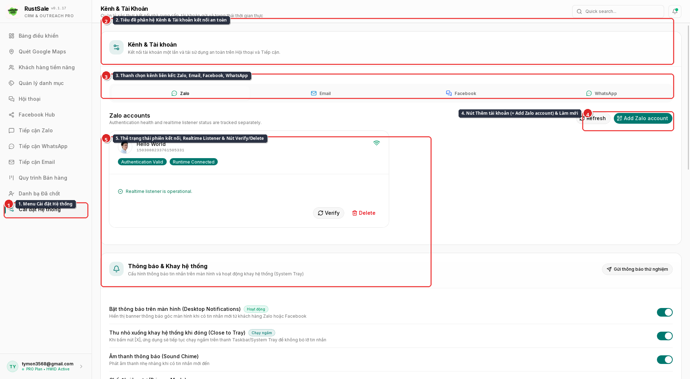

# ⚙️ Hướng Dẫn Sử Dụng: Cài Đặt Hệ Thống & Quản Lý Kênh Kết Nối (Settings)

> 💡 **Tổng quan:** Phân hệ **Cài Đặt Hệ Thống (Settings)** là nơi quản lý toàn bộ các kết nối tài khoản đa kênh (Zalo cá nhân, Zalo OA, Email SMTP, Facebook Fanpage, WhatsApp Web/API), kiểm tra trạng thái lắng nghe thời gian thực (Realtime Listener) và quản lý bản quyền thiết bị phần cứng (HWID License).

---

## 📸 Giao Diện Cài Đặt Hệ Thống

---

## 📌 Hướng Dẫn Thao Tác Chi Tiết

### ❶ Menu Điều Hướng "Cài Đặt Hệ Thống"
* Nhấp vào mục cuối cùng trên thanh sidebar bên trái để mở bảng cấu hình hệ thống.

---

### ❷ Khu Vực Quản Lý Kênh & Tài Khoản Kết Nối
* Khẩu hiệu vận hành: *"Kết nối tài khoản một lần và tái sử dụng an toàn trên Hội thoại và Tiếp cận"*.
* Đảm bảo tính bảo mật tuyệt đối nhờ cơ chế lưu trữ mã hóa Keyring Vault cục bộ trên máy tính của bạn.

---

### ❸ Các Tab Kênh Kết Nối
Chuyển đổi giữa các kênh liên kết:
* **💬 Zalo:** Quản lý các tài khoản Zalo cá nhân được kết nối vào hệ thống.
* **✉️ Email:** Quản lý tài khoản gửi thư SMTP (Gmail, Outlook, Resend, Amazon SES).
* **🌐 Facebook:** Kết nối Access Token Fanpage Facebook và quản lý quyền Page.
* **📱 WhatsApp:** Quản lý phiên quét mã QR WhatsApp Web.

---

### ❹ Thao Tác Thêm Tài Khoản Mới
* **Nút `+ Add Zalo account` (Kèm biểu tượng mã QR):**
  * Nhấp vào nút này để mở cửa sổ quét mã QR.
  * Mở ứng dụng Zalo trên điện thoại của bạn -> Chọn tính năng quét mã QR -> Quét mã trên màn hình máy tính -> Xác nhận đăng nhập.
  * Hệ thống sẽ tự động bắt phiên và lưu trữ phiên đăng nhập vĩnh viễn.
* **Nút `Refresh`:** Kiểm tra lại tình trạng kết nối của tất cả các tài khoản.

---

### ❺ Thẻ Trạng Thái Tài Khoản & Realtime Listener
* **Thông tin tài khoản:** Avatar, Tên đại diện (Ví dụ: `Hello World`) và Mã IMEI định danh phiên kết nối.
* **Huy hiệu sức khỏe kết nối:**
  * `Authentication Valid`: Phiên đăng nhập hợp lệ, không bị hết hạn.
  * `Runtime Connected`: Đã kết nối thành công với máy chủ tin nhắn.
* **Dòng thông báo:** `✓ Realtime listener is operational`: Bộ máy lắng nghe tin nhắn đến đang hoạt động hoàn hảo, đảm bảo khi có khách nhắn tin vào Zalo điện thoại thì app máy tính sẽ nhận được ngay tức thì.
* **Nút chức năng:**
  * `Verify`: Kiểm tra lại kết nối.
  * `Delete` (Màu đỏ): Hủy liên kết tài khoản khỏi máy tính khi cần đổi tài khoản khác.

---

> [!IMPORTANT]
> **Quản lý Bản quyền & HWID:** Tài khoản của bạn được kích hoạt theo chế độ `PRO Plan • HWID Active` gắn liền với mã định danh máy tính phần cứng để đảm bảo quyền lợi sở hữu độc quyền và tự động nhận các bản cập nhật tính năng mới qua Cloudflare R2.
